# DD-MB - Dispatcher

---

- [English (EN)](#english)
- [Čeština (CZ)](#čeština)
- [Slovenčina (SK)](#slovenčina)
- [Polski (PL)](#polski)
- [Deutsch (DE)](#deutsch)
- [Magyar (HU)](#magyar)

---

## English

### Table of Contents

- [Basic View](#basic-view)
- [Blocks](#blocks)
- [Adding Train to Layout](#adding-train-to-layout)
- [Incoming Trains](#incoming-trains)
- [Operating Trains in Station](#operating-trains-in-station)
- [Removing Trains](#removing-trains)
- [Pass-Through Trains](#pass-through-trains)
- [Rejected Train Offers](#rejected-train-offers)
- [Train Notes](#train-notes)
- [Extra Train](#extra-train)
- [Display Train Drivers](#display-train-drivers)
- [Graphical Timetables](#graphical-timetables)
- [Active on Top](#active-on-top)
- [Station Log](#station-log)
- [Messaging](#messaging)

---

### Basic View

The screenshot below shows the default dispatcher view in DD-MB.

**Main screen:**

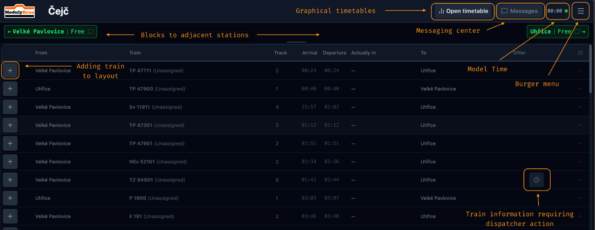

Highlighted areas:

- **Graphical timetables** — Opens a graphical timetable (SVG) if one has been imported by the admin.
- **Messaging centre** — Instant messaging between stations or broadcast message to all stations.
- **Model time** — Current model time. Displays `00:00` when no time source is active.
- **Burger menu** — Additional options and settings for the dispatcher view.
- **Blocks** — Route blocks to adjacent stations on the left and right side of the dispatcher's station.
- **Add train** — Adds a train to the layout. Used primarily at hidden stations or at stations adjacent to an automatic hidden station.
- **Action banner** — Appears when a train or train unit requires dispatcher attention (e.g. incoming offer, departure pending).
- **Connection status** — A small dot next to the model time indicates the server connection state: green when connected, red (blinking) when disconnected.

**Burger menu:**

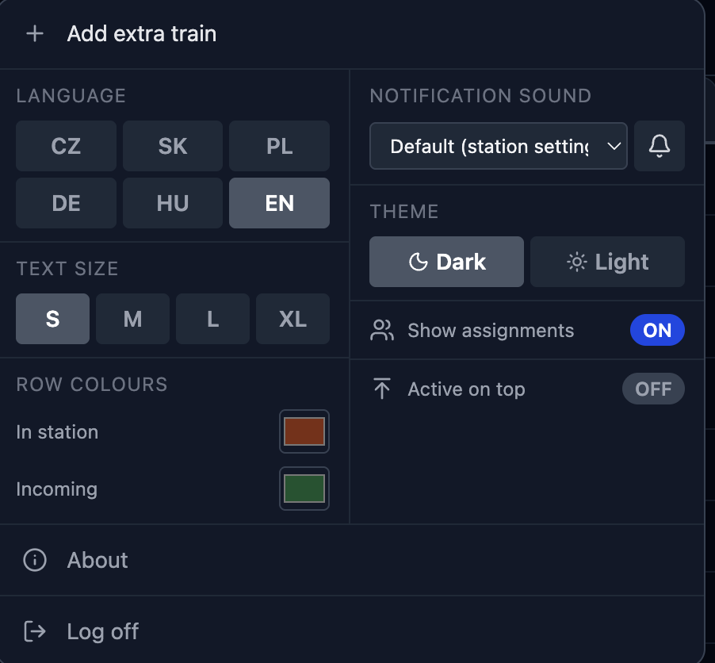

Burger menu options:

| Option | Description |
|---|---|
| **Add extra train** | Adds a train to the layout without restrictions. For special or emergency situations. |
| **Language** | Switches the dispatcher view language. |
| **Text size** | Adjusts font size for readability. |
| **Row colors** | Customises background highlight colours for incoming and stationed trains. |
| **Notification sound** | Selects the alert sound played when an incoming train offer arrives. |
| **Theme** | Switches between Dark (default) and Light theme. |
| **Show Assignments** | Toggles display of assigned driver names per train (requires the Turnusy/Rosters feature). |
| **Active on top** | Toggles sorting "active on top". |
| **Reset sort order** | Shown only when "Active on top" is enabled. Restores the manual ordering of active trains to the default departure-time order. |
| **About** | Shows app version and information. |
| **Log off** | Returns to the station selection screen. |

**Dispatcher table:**

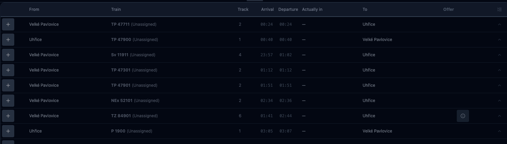

Columns from left to right:

| Column | Description |
|---|---|
| **+** | Add train to layout. Essential for hidden stations and stations adjacent to automatic hidden stations. |
| **From** | Previous station the train comes from. |
| **Train** | Train name. If Turnusy/Rosters are enabled, the assigned driver name is shown in brackets. |
| **Track** | Platform/track number from Grafikon. Editable while the train is active — select from the station's configured track list, or type a custom value if none is configured. For reference only — does not affect train movement logic. |
| **Arrival** | Scheduled arrival time. Click to confirm train arrival at this station. |
| **Departure** | Scheduled departure time. Click to confirm train departure from this station. |
| **Currently at** | Last station where the train's arrival was confirmed. |
| **To** | Next station the train is heading to. |
| **Offer** | Offer or retract button. Appears once the train is stationed or an offer has been sent. |
| **↕** | Collapse/expand button. In the table header it collapses all processed trains; on a train row it collapses that individual row. |

---

### Blocks

Route blocks represent the physical track sections between adjacent stations. They are displayed below the header on the left and right side.

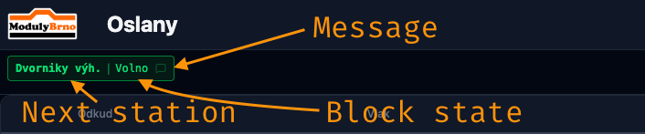

The left/right positioning reflects the physical layout of the line and is configured per station in the Admin portal. Each block shows:

- Adjacent station name.
- Train name and directional arrow (when a train is offered or occupying the block).
- Block state (colour).
- Direct message input to send a message to the adjacent station.
- Bell icon — rings an alert at the adjacent station (available when the block is occupied).

**Block colours:**

| Colour | Meaning |
| --- | --- |
| 🟢 Green | Block is free. |
| 🟡 Yellow | A train offer is pending (waiting for acceptance). |
| 🔴 Red | Offer was accepted — block is occupied by a train. |

**Directional arrows** on a train entry indicate the train's direction of travel relative to this station:

- Arrow pointing **into** the station = incoming train.
- Arrow pointing **away** from the station = outgoing train.

**Multi-track blocks** display a track number for each slot when a section has more than one track:

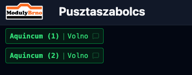

**Reordering blocks:**

Blocks can be rearranged by drag and drop. A blue border highlights the drop target position. Blocks can be reordered both horizontally (side by side) and vertically (stacked rows).

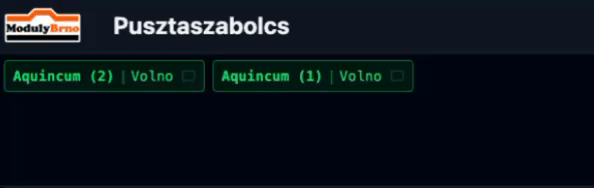

**Offered state** — block turns yellow, train name and directional arrow appear, and a bell icon is shown so the dispatcher can alert the adjacent station if needed:

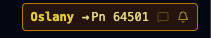

**Accepted state** — block turns red, train keeps yellow as it's still stationed. All other information remains the same as offered state:

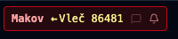

**Dispatched state** — block is red, train name turns red once departure is confirmed:

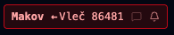

---

### Adding Train to Layout

Click the **+** button in the train table to add a train to the layout.

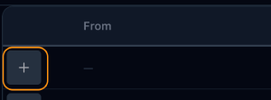

Once added, the train appears in the station view with appropriate highlighting. The **+** button disappears for that train at all other stations — a train can only be added once.

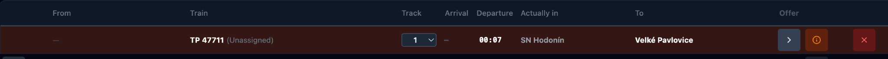

> [!IMPORTANT]
> If you add a train at a station other than its scheduled origin, a confirmation prompt will appear. Adding a train away from its origin may break its circulation. Use this only when necessary.

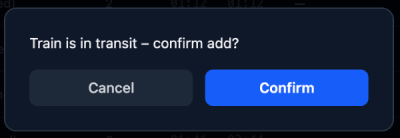

---

### Incoming Trains

When an adjacent station offers a train, an audio alert plays, the train row is highlighted, and the adjacent route block turns yellow. The dispatcher must either accept or decline the offer.

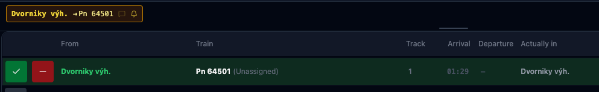

If declining, the dispatcher must provide a reason.

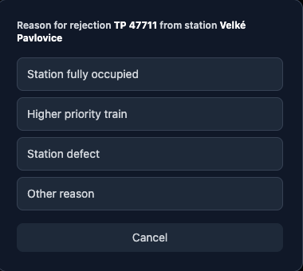

When the offer is accepted:

- The adjacent route block turns red.
- If the train has already departed the adjacent station (or is en route), the **arrival time** turns green and becomes clickable. Clicking it confirms the train's arrival at this station.
- If the train has not yet departed, the offer can still be retracted using the minus (−) button.

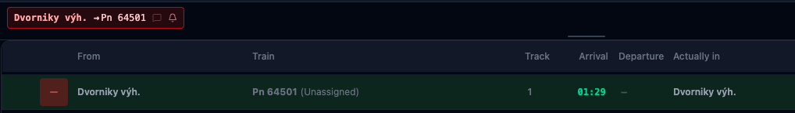

Once accepted, if the train is still at the adjacent station, it is also possible to immediately forward the offer to the next station — see [Pass-Through Trains](#pass-through-trains).

> [!NOTE]
> DD-MB is not an interlocking system. The software does not prevent a second train from being offered into an occupied block. Dispatchers are responsible for safe operation.

**Incoming offer out of view:**

If the offered train is not visible in the current scroll position, a yellow alert banner appears with the train details and a scroll direction arrow. Clicking the banner centres the view on that train.

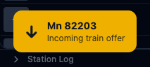

Alternatively, clicking the train name directly in the yellow route block scrolls to the train row.

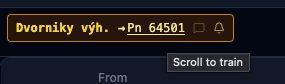

---

### Operating Trains in Station

When a train's arrival is confirmed, its row background changes to the stationed colour. Two actions are available:

- **>** — Offer the train to the next station.
- **✕** — Remove the train from the layout.

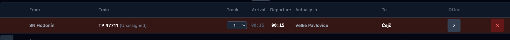

Clicking **>** offers the train to the adjacent station. The route block turns yellow while waiting for the adjacent dispatcher to respond.

> [!TIP]
> If the adjacent dispatcher does not respond, click the bell icon in the route block to trigger a sound alert at their station. The dispatcher will also be notified by a banner.
> 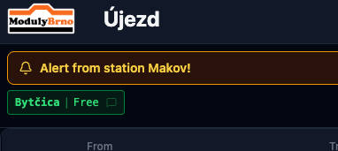

The offer can be retracted at any time before the train departs by clicking the minus (−) button in the Offer column. To confirm departure, click the highlighted departure time.

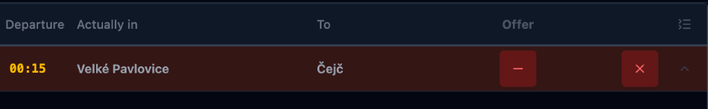

If the train has already been dispatched and is occupying the block, it may still be retracted until the adjacent station confirms arrival. The retract button appears as a back-arrow (↩) in the Offer column.

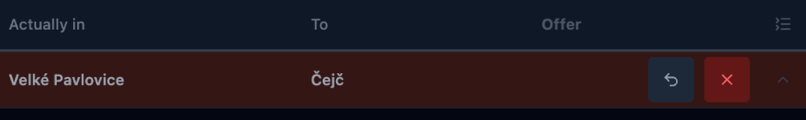

---

### Removing Trains

Trains can be removed from the layout by clicking the **✕** button.

- **At a terminus station** — the train is permanently removed; its circulation is considered complete. The train cannot be re-added until a layout reset is performed in the Admin portal.
- **At any other station** — a dialog asks whether the removal should be permanent. Permanent removal is unchecked by default. Use permanent removal only in exceptional circumstances (e.g. locomotive failure). To remove a train mid-route, you must provide the *removal* password configurable in the Admin portal. By default it matches the admin password.

---

### Pass-Through Trains

A pass-through occurs when a train is forwarded to the next station before it physically arrives. This is useful for express or non-stopping trains.

When the offer from an adjacent station is accepted and the train has not yet arrived, clicking the offer (**>**) button immediately forwards the offer to the next station. The departure time is highlighted in a distinct colour to distinguish pass-through from standard departures. Clicking that departure time simultaneously confirms arrival and departure.

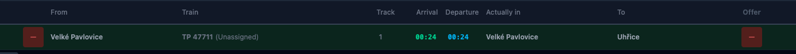

---

### Rejected Train Offers

If an adjacent station rejects a train offer, a small **ℹ** button appears next to the offer button on the train row. Clicking it shows the reason provided by the rejecting dispatcher.

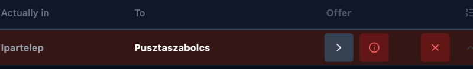

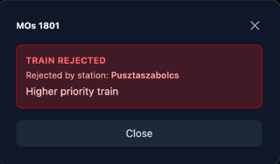

---

### Train Notes

Some stations require special operations for certain trains — freight preparation, locomotive changes, uncoupling, etc. When such a note exists (imported from Grafikon), an info (**ℹ**) icon appears on the train row. Clicking it shows the full note.

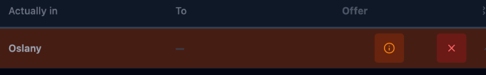

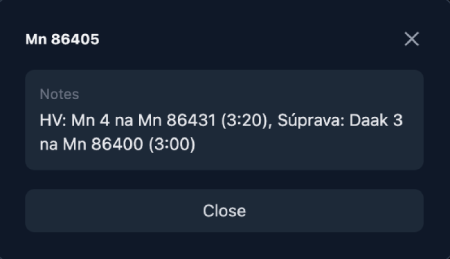

---

### Extra Train

An extra train is a train added to the layout outside the normal schedule — with no restrictions on timing or origin. Use this for special or emergency situations.

Open the burger menu and select **Add extra train**. Enter the train number and click **Add**.

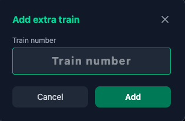

The extra train appears at the top of the train list at the current model time.

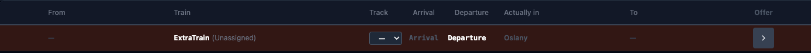

It can be offered to any adjacent station like any other train.

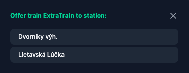

---

### Display Train Drivers

If the Turnusy/Rosters feature is configured, each train can have an assigned driver. To show driver names in the dispatcher view, open the burger menu and enable **Show assignments**.

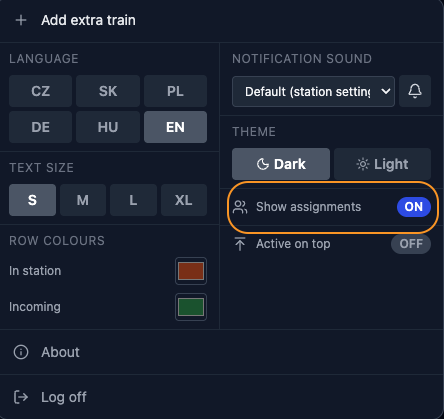

When enabled, the assigned driver's name appears next to the train name in the train list.

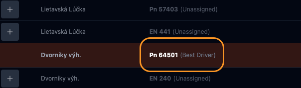

The toggle is off by default.

---

### Graphical Timetables

If SVG timetables have been imported by the admin, they can be opened from the dispatcher view by clicking the **Open timetable** button in the header.

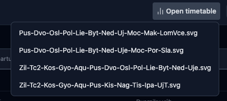

A list of available timetables appears. Select one to open it in a new window.

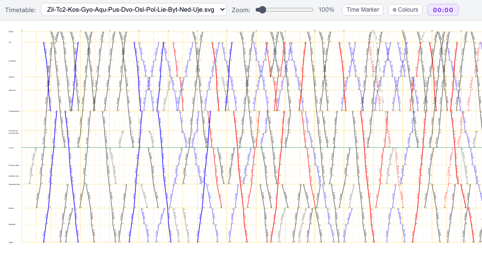

If the timetable contains the current station, it is highlighted automatically. Use the zoom bar to enlarge the image. If model time is active, a current-time marker can be toggled for easier orientation.

You can always click on train name in dispatcher view. This action will highlight selected train in graphical timetable view.

---

### Active on Top

By default, trains are sorted by departure time as exported from Grafikon. In larger stations it can be useful to keep active trains at the top of the list. Enable **Active on top** from the burger menu to sort the train list into three groups, top to bottom: **completed**, **active**, **upcoming** — each group still sorted internally by departure time.

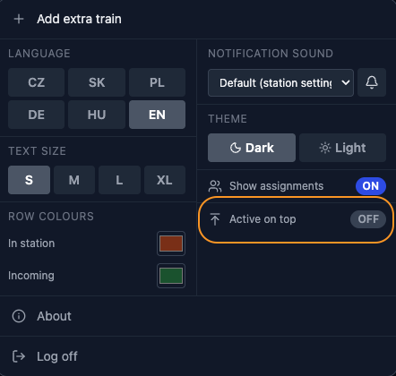

When enabled, small up/down arrows appear on each active train row, letting the dispatcher manually reorder active trains within their group (e.g. to match track assignment order). Once an active train is completed for the dispatcher (e.g. its arrival is confirmed at the next station), it automatically moves up into the completed group.

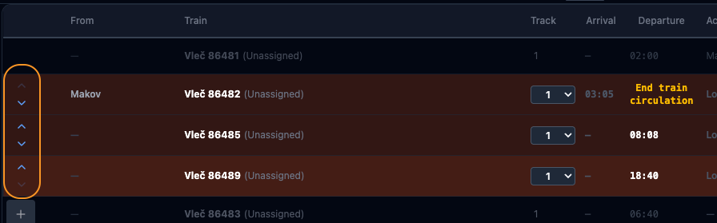

Use **Reset sort order** in the burger menu to discard manual ordering and return to the default departure-time sort.

---

### Station Log

At the very bottom of screen there is Station Log. It can be expanded via small row arrow, and its height can be adjusted by dragging the handle above it. The log contains what is happening in station and globally, split into two tabs: **Local** (events at this station) and **Global** (events across all stations). Use the filter box to search log entries by train ID.

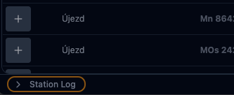

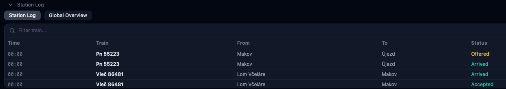

---

### Messaging

There is built-in feature for instant messaging. There are two ways how to access is. Generally via messaging tab or directly to adjacent station via messaging icon on block.

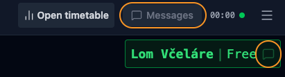

When accessing via messaging block you can choose recipient or broadcast message to all stations.

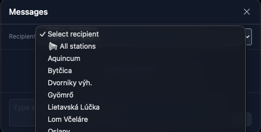

Clicking on message icon on block will directly pre-select recipient.

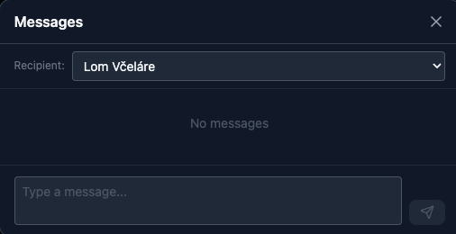

When there are unread incoming messages the button turns blue. If it comes from adjacent block even the block message icon is turned blue.

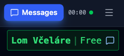

---

---

## Čeština

### Obsah

- [Základní zobrazení](#základní-zobrazení)
- [Bloky](#bloky)
- [Přidání vlaku do rozložení](#přidání-vlaku-do-rozložení)
- [Přijíždějící vlaky](#přijíždějící-vlaky)
- [Ovládání vlaků ve stanici](#ovládání-vlaků-ve-stanici)
- [Odebrání vlaků](#odebrání-vlaků)
- [Průjezdné vlaky](#průjezdné-vlaky)
- [Odmítnuté nabídky vlaků](#odmítnuté-nabídky-vlaků)
- [Poznámky k vlaku](#poznámky-k-vlaku)
- [Mimořádný vlak](#mimořádný-vlak)
- [Zobrazení strojvedoucích](#zobrazení-strojvedoucích)
- [Grafické jízdní řády](#grafické-jízdní-řády)
- [Aktivní nahoře](#aktivní-nahoře)
- [Deník stanice](#deník-stanice)
- [Zprávy](#zprávy)

---

### Základní zobrazení

Snímek obrazovky níže zobrazuje výchozí zobrazení výpravčího v DD-MB.

**Hlavní obrazovka:**

Zvýrazněné oblasti:

- **Grafické jízdní řády** — Otevře grafický jízdní řád (SVG), pokud jej administrátor naimportoval.
- **Centrum zpráv** — Okamžité zasílání zpráv mezi stanicemi nebo hromadná zpráva všem stanicím.
- **Modelový čas** — Aktuální modelový čas. Zobrazuje `00:00`, pokud není aktivní žádný zdroj času.
- **Burger menu** — Další možnosti a nastavení pro zobrazení výpravčího.
- **Bloky** — Traťové úseky k sousedním stanicím na levé a pravé straně stanice výpravčího.
- **Přidat vlak** — Přidá vlak do rozložení. Používá se především ve skrytých stanicích nebo ve stanicích sousedících s automatickou skrytou stanicí.
- **Panel akcí** — Objeví se, pokud vlak nebo vlaková jednotka vyžaduje pozornost výpravčího (např. příchozí nabídka, čekající odjezd).
- **Stav připojení** — Malá tečka vedle modelového času ukazuje stav připojení k serveru: zelená znamená připojeno, červená (blikající) znamená odpojeno.

**Burger menu:**

Možnosti burger menu:

| Možnost | Popis |
|---|---|
| **Přidat mimořádný vlak** | Přidá vlak do rozložení bez omezení. Pro mimořádné nebo nouzové situace. |
| **Jazyk** | Přepíná jazyk zobrazení výpravčího. |
| **Velikost textu** | Upravuje velikost písma pro lepší čitelnost. |
| **Barvy řádků** | Přizpůsobuje barvy zvýraznění pozadí pro přijíždějící a stojící vlaky. |
| **Zvuk upozornění** | Vybírá zvuk upozornění přehrávaný při příchozí nabídce vlaku. |
| **Motiv** | Přepíná mezi tmavým (výchozí) a světlým motivem. |
| **Zobrazit přiřazení** | Přepíná zobrazení jména přiřazeného strojvedoucího u vlaku (vyžaduje funkci Turnusy). |
| **Aktivní nahoře** | Přepíná řazení „aktivní nahoře". |
| **Resetovat řazení** | Zobrazí se pouze, když je zapnuto „Aktivní nahoře". Obnoví ruční řazení aktivních vlaků na výchozí řazení podle odjezdu. |
| **O aplikaci** | Zobrazuje verzi a informace o aplikaci. |
| **Odhlásit se** | Vrátí se na obrazovku výběru stanice. |

**Tabulka výpravčího:**

Sloupce zleva doprava:

| Sloupec | Popis |
|---|---|
| **+** | Přidá vlak do rozložení. Nezbytné pro skryté stanice a stanice sousedící s automatickou skrytou stanicí. |
| **Odkud** | Předchozí stanice, ze které vlak přijíždí. |
| **Vlak** | Název vlaku. Pokud jsou zapnuty Turnusy, jméno přiřazeného strojvedoucího se zobrazuje v závorce. |
| **Kolej** | Číslo koleje/nástupiště z Grafikonu. Upravitelné, dokud je vlak aktivní — vyberte z nastaveného seznamu kolejí stanice, nebo zadejte vlastní hodnotu, pokud žádný není nastaven. Pouze pro informaci — neovlivňuje logiku pohybu vlaku. |
| **Příjezd** | Plánovaný čas příjezdu. Klikněte pro potvrzení příjezdu vlaku do této stanice. |
| **Odjezd** | Plánovaný čas odjezdu. Klikněte pro potvrzení odjezdu vlaku z této stanice. |
| **Aktuálně v** | Poslední stanice, kde byl potvrzen příjezd vlaku. |
| **Kam** | Další stanice, kam vlak směřuje. |
| **Nabídka** | Tlačítko nabídky nebo stažení nabídky. Objeví se, jakmile vlak stojí ve stanici nebo byla nabídka odeslána. |
| **↕** | Tlačítko sbalit/rozbalit. V záhlaví tabulky sbalí všechny odbavené vlaky; na řádku vlaku sbalí jen daný řádek. |

---

### Bloky

Traťové bloky představují fyzické úseky trati mezi sousedními stanicemi. Zobrazují se pod záhlavím na levé a pravé straně.

Umístění vlevo/vpravo odpovídá fyzickému uspořádání tratě a je nastaveno pro každou stanici v administrátorském portálu. Každý blok zobrazuje:

- Název sousední stanice.
- Název vlaku a směrovou šipku (pokud je vlak nabízen nebo obsazuje blok).
- Stav bloku (barva).
- Pole pro přímou zprávu sousední stanici.
- Ikonu zvonku — vyzvání upozornění u sousední stanice (dostupné, pokud je blok obsazen).

**Barvy bloku:**

| Barva | Význam |
| --- | --- |
| 🟢 Zelená | Blok je volný. |
| 🟡 Žlutá | Nabídka vlaku čeká na přijetí. |
| 🔴 Červená | Nabídka byla přijata — blok je obsazen vlakem. |

**Směrové šipky** u položky vlaku ukazují směr jízdy vlaku vzhledem k této stanici:

- Šipka směřující **do** stanice = přijíždějící vlak.
- Šipka směřující **od** stanice = odjíždějící vlak.

**Vícekolejné bloky** zobrazují číslo koleje pro každou pozici, pokud má úsek více kolejí:

**Přeuspořádání bloků:**

Bloky lze přeuspořádat přetažením (drag and drop). Modrý rámeček zvýrazňuje cílovou pozici pro upuštění. Bloky lze přeuspořádat jak vodorovně (vedle sebe), tak svisle (v řadách nad sebou).

**Stav nabídnuto** — blok zežloutne, objeví se název vlaku a směrová šipka a zobrazí se ikona zvonku, kterou může výpravčí upozornit sousední stanici:

**Stav přijato** — blok zčervená, jméno vlaku zůstává žluté, protože stále stojí ve stanici. Ostatní informace zůstávají stejné jako u stavu nabídnuto:

**Stav odjeto** — blok je červený, jméno vlaku zčervená, jakmile je potvrzen odjezd:

---

### Přidání vlaku do rozložení

Klikněte na tlačítko **+** v tabulce vlaků pro přidání vlaku do rozložení.

Po přidání se vlak zobrazí ve zobrazení stanice s příslušným zvýrazněním. Tlačítko **+** pro tento vlak zmizí ve všech ostatních stanicích — vlak lze přidat pouze jednou.

> [!IMPORTANT]
> Pokud přidáte vlak v jiné stanici, než je jeho plánovaná výchozí stanice, zobrazí se potvrzovací dotaz. Přidání vlaku mimo jeho výchozí stanici může narušit jeho oběh. Používejte pouze v nezbytných případech.

---

### Přijíždějící vlaky

Když sousední stanice nabídne vlak, zazní zvukové upozornění, řádek vlaku se zvýrazní a sousední traťový blok zežloutne. Výpravčí musí nabídku buď přijmout, nebo odmítnout.

Při odmítnutí musí výpravčí uvést důvod.

Po přijetí nabídky:

- Sousední traťový blok zčervená.
- Pokud vlak již odjel ze sousední stanice (nebo je na cestě), **čas příjezdu** zezelená a stane se klikatelným. Kliknutím se potvrdí příjezd vlaku do této stanice.
- Pokud vlak ještě neodjel, lze nabídku stále stáhnout tlačítkem mínus (−).

Po přijetí, pokud vlak stále stojí v sousední stanici, je také možné nabídku okamžitě předat další stanici — viz [Průjezdné vlaky](#průjezdné-vlaky).

> [!NOTE]
> DD-MB není zabezpečovací systém. Software nezabraňuje nabídnutí druhého vlaku do obsazeného bloku. Za bezpečný provoz odpovídají výpravčí.

**Příchozí nabídka mimo zobrazení:**

Pokud nabídnutý vlak není viditelný v aktuální pozici posunutí, objeví se žlutý banner s upozorněním, obsahující údaje o vlaku a šipku směru posunutí. Kliknutím na banner se zobrazení vycentruje na daný vlak.

Alternativně kliknutím na jméno vlaku přímo ve žlutém traťovém bloku se zobrazení přesune na řádek vlaku.

---

### Ovládání vlaků ve stanici

Jakmile je potvrzen příjezd vlaku, pozadí jeho řádku se změní na barvu stojícího vlaku. K dispozici jsou dvě akce:

- **>** — Nabídnout vlak další stanici.
- **✕** — Odebrat vlak z rozložení.

Kliknutím na **>** se vlak nabídne sousední stanici. Traťový blok zežloutne, dokud sousední výpravčí neodpoví.

> [!TIP]
> Pokud sousední výpravčí neodpovídá, klikněte na ikonu zvonku v traťovém bloku a vyvolejte zvukové upozornění v jeho stanici. Výpravčí bude také upozorněn bannerem.
> 

Nabídku lze stáhnout kdykoliv před odjezdem vlaku kliknutím na tlačítko mínus (−) ve sloupci Nabídka. Pro potvrzení odjezdu klikněte na zvýrazněný čas odjezdu.

Pokud byl vlak již odbaven a obsazuje blok, lze jej stále stáhnout, dokud sousední stanice nepotvrdí příjezd. Tlačítko stažení se zobrazuje jako zpětná šipka (↩) ve sloupci Nabídka.

---

### Odebrání vlaků

Vlaky lze odebrat z rozložení kliknutím na tlačítko **✕**.

- **V koncové stanici** — vlak je trvale odebrán; jeho oběh je považován za dokončený. Vlak nelze znovu přidat, dokud není v administrátorském portálu proveden reset rozložení.
- **V jakékoliv jiné stanici** — objeví se dialog s dotazem, zda má být odebrání trvalé. Trvalé odebrání je ve výchozím stavu nezaškrtnuté. Trvalé odebrání používejte pouze ve výjimečných případech (např. porucha lokomotivy). Pro odebrání vlaku uprostřed trasy musíte zadat heslo pro *odebrání*, nastavitelné v administrátorském portálu. Ve výchozím stavu odpovídá heslu administrátora.

---

### Průjezdné vlaky

Průjezd nastává, když je vlak předán další stanici dříve, než fyzicky dorazí. To je užitečné pro expresní nebo nezastavující vlaky.

Když je nabídka ze sousední stanice přijata a vlak ještě nedorazil, kliknutím na tlačítko nabídky (**>**) se nabídka okamžitě předá další stanici. Čas odjezdu je zvýrazněn odlišnou barvou, aby se průjezd odlišil od standardního odjezdu. Kliknutím na tento čas odjezdu se současně potvrdí příjezd i odjezd.

---

### Odmítnuté nabídky vlaků

Pokud sousední stanice odmítne nabídku vlaku, objeví se u řádku vlaku vedle tlačítka nabídky malé tlačítko **ℹ**. Kliknutím na něj se zobrazí důvod uvedený odmítajícím výpravčím.

---

### Poznámky k vlaku

Některé stanice vyžadují u určitých vlaků zvláštní úkony — přípravu nákladu, výměnu lokomotivy, odpojování vozů apod. Pokud taková poznámka existuje (importovaná z Grafikonu), objeví se na řádku vlaku ikona informace (**ℹ**). Kliknutím na ni se zobrazí celá poznámka.

---

### Mimořádný vlak

Mimořádný vlak je vlak přidaný do rozložení mimo běžný jízdní řád — bez omezení ohledně času nebo výchozí stanice. Používejte pro mimořádné nebo nouzové situace.

Otevřete burger menu a vyberte **Přidat mimořádný vlak**. Zadejte číslo vlaku a klikněte na **Přidat**.

Mimořádný vlak se objeví na začátku seznamu vlaků v aktuálním modelovém čase.

Lze jej nabídnout jakékoliv sousední stanici jako kterýkoliv jiný vlak.

---

### Zobrazení strojvedoucích

Pokud je nakonfigurována funkce Turnusy, každý vlak může mít přiřazeného strojvedoucího. Pro zobrazení jmen strojvedoucích v zobrazení výpravčího otevřete burger menu a zapněte **Zobrazit přiřazení**.

Po zapnutí se jméno přiřazeného strojvedoucího zobrazí vedle jména vlaku v seznamu vlaků.

Přepínač je ve výchozím stavu vypnutý.

---

### Grafické jízdní řády

Pokud administrátor naimportoval SVG jízdní řády, lze je otevřít ze zobrazení výpravčího kliknutím na tlačítko **Otevřít jízdní řád** v záhlaví.

Objeví se seznam dostupných jízdních řádů. Vyberte jeden pro otevření v novém okně.

Pokud jízdní řád obsahuje aktuální stanici, je automaticky zvýrazněna. Pro zvětšení obrázku použijte lištu přiblížení. Pokud je aktivní modelový čas, lze zapnout značku aktuálního času pro snazší orientaci.

Kdykoliv můžete kliknout na název vlaku v zobrazení výpravčího. Tato akce zvýrazní vybraný vlak v grafickém jízdním řádu.

---

### Aktivní nahoře

Ve výchozím stavu je řazení prováděno podle času odjezdu, jak byl exportován z Grafikonu. Ve větších stanicích může být užitečné držet aktivní vlaky nahoře v seznamu. Zapněte **Aktivní nahoře** v burger menu, aby se seznam vlaků seřadil do tří skupin, shora dolů: **dokončené**, **aktivní**, **nadcházející** — každá skupina je uvnitř dále seřazena podle času odjezdu.

Po zapnutí se u každého aktivního vlaku objeví malé šipky nahoru/dolů, které umožňují výpravčímu ručně přeuspořádat aktivní vlaky v rámci jejich skupiny (např. podle přiřazení kolejí). Jakmile je aktivní vlak pro výpravčího dokončen (např. je potvrzen jeho příjezd do další stanice), automaticky se přesune nahoru do skupiny dokončených.

Pomocí **Resetovat řazení** v burger menu zrušíte ruční řazení a vrátíte se k výchozímu řazení podle času odjezdu.

---

### Deník stanice

V úplně dolní části obrazovky se nachází Deník stanice. Lze jej rozbalit pomocí malé šipky u řádku a jeho výšku lze upravit tažením úchytu nad ním. Deník obsahuje záznamy o dění ve stanici a globálně, rozdělené do dvou záložek: **Místní** (události v této stanici) a **Globální** (události napříč všemi stanicemi). Pomocí filtru vyhledejte záznamy podle čísla vlaku.

---

### Zprávy

Aplikace obsahuje vestavěnou funkci pro okamžité zasílání zpráv. Existují dva způsoby přístupu k ní — obecně přes záložku zpráv, nebo přímo sousední stanici přes ikonu zpráv na bloku.

Při přístupu přes blok zpráv můžete vybrat příjemce nebo odeslat hromadnou zprávu všem stanicím.

Kliknutím na ikonu zprávy na bloku se příjemce přímo přednastaví.

Pokud existují nepřečtené příchozí zprávy, tlačítko zmodrá. Pokud zpráva přichází ze sousedního bloku, zmodrá i ikona zprávy na bloku.

---

---

## Slovenčina

### Obsah

- [Základné zobrazenie](#základné-zobrazenie)
- [Bloky](#bloky)
- [Pridanie vlaku do rozloženia](#pridanie-vlaku-do-rozloženia)
- [Prichádzajúce vlaky](#prichádzajúce-vlaky)
- [Ovládanie vlakov v stanici](#ovládanie-vlakov-v-stanici)
- [Odobratie vlakov](#odobratie-vlakov)
- [Prejazdné vlaky](#prejazdné-vlaky)
- [Odmietnuté ponuky vlakov](#odmietnuté-ponuky-vlakov)
- [Poznámky k vlaku](#poznámky-k-vlaku)
- [Mimoriadny vlak](#mimoriadny-vlak)
- [Zobrazenie rušňovodičov](#zobrazenie-rušňovodičov)
- [Grafické cestovné poriadky](#grafické-cestovné-poriadky)
- [Aktívne navrchu](#aktívne-navrchu)
- [Denník stanice](#denník-stanice)
- [Správy](#správy)

---

### Základné zobrazenie

Snímka obrazovky nižšie zobrazuje predvolené zobrazenie výpravcu v DD-MB.

**Hlavná obrazovka:**

Zvýraznené oblasti:

- **Grafické cestovné poriadky** — Otvorí grafický cestovný poriadok (SVG), ak ho administrátor naimportoval.
- **Centrum správ** — Okamžité odosielanie správ medzi stanicami alebo hromadná správa všetkým staniciam.
- **Modelový čas** — Aktuálny modelový čas. Zobrazuje `00:00`, ak nie je aktívny žiadny zdroj času.
- **Burger menu** — Ďalšie možnosti a nastavenia pre zobrazenie výpravcu.
- **Bloky** — Traťové úseky k susedným staniciam na ľavej a pravej strane stanice výpravcu.
- **Pridať vlak** — Pridá vlak do rozloženia. Používa sa najmä v skrytých staniciach alebo v staniciach susediacich s automatickou skrytou stanicou.
- **Panel akcií** — Zobrazí sa, keď vlak alebo vlaková jednotka vyžaduje pozornosť výpravcu (napr. prichádzajúca ponuka, čakajúci odchod).
- **Stav pripojenia** — Malá bodka vedľa modelového času ukazuje stav pripojenia k serveru: zelená znamená pripojené, červená (blikajúca) znamená odpojené.

**Burger menu:**

Možnosti burger menu:

| Možnosť | Popis |
|---|---|
| **Pridať mimoriadny vlak** | Pridá vlak do rozloženia bez obmedzení. Pre mimoriadne alebo núdzové situácie. |
| **Jazyk** | Prepína jazyk zobrazenia výpravcu. |
| **Veľkosť textu** | Upravuje veľkosť písma pre lepšiu čitateľnosť. |
| **Farby riadkov** | Prispôsobuje farby zvýraznenia pozadia pre prichádzajúce a stojace vlaky. |
| **Zvuk upozornenia** | Vyberá zvuk upozornenia prehrávaný pri prichádzajúcej ponuke vlaku. |
| **Motív** | Prepína medzi tmavým (predvolené) a svetlým motívom. |
| **Zobraziť priradenia** | Prepína zobrazenie mena priradeného rušňovodiča pri vlaku (vyžaduje funkciu Turnusy). |
| **Aktívne navrchu** | Prepína zoradenie „aktívne navrchu". |
| **Resetovať zoradenie** | Zobrazí sa iba vtedy, keď je zapnuté „Aktívne navrchu". Obnoví ručné zoradenie aktívnych vlakov na predvolené zoradenie podľa odchodu. |
| **O aplikácii** | Zobrazuje verziu a informácie o aplikácii. |
| **Odhlásiť sa** | Vráti sa na obrazovku výberu stanice. |

**Tabuľka výpravcu:**

Stĺpce zľava doprava:

| Stĺpec | Popis |
|---|---|
| **+** | Pridá vlak do rozloženia. Nevyhnutné pre skryté stanice a stanice susediace s automatickou skrytou stanicou. |
| **Odkiaľ** | Predchádzajúca stanica, z ktorej vlak prichádza. |
| **Vlak** | Názov vlaku. Ak sú zapnuté Turnusy, meno priradeného rušňovodiča sa zobrazuje v zátvorke. |
| **Koľaj** | Číslo koľaje/nástupišťa z Grafikonu. Upraviteľné, kým je vlak aktívny — vyberte zo zoznamu koľají nastaveného pre stanicu, alebo zadajte vlastnú hodnotu, ak žiadny nie je nastavený. Iba na informáciu — neovplyvňuje logiku pohybu vlaku. |
| **Príchod** | Plánovaný čas príchodu. Kliknutím potvrdíte príchod vlaku do tejto stanice. |
| **Odchod** | Plánovaný čas odchodu. Kliknutím potvrdíte odchod vlaku z tejto stanice. |
| **Aktuálne v** | Posledná stanica, kde bol potvrdený príchod vlaku. |
| **Kam** | Ďalšia stanica, kam vlak smeruje. |
| **Ponuka** | Tlačidlo ponuky alebo stiahnutia ponuky. Zobrazí sa, keď vlak stojí v stanici alebo bola ponuka odoslaná. |
| **↕** | Tlačidlo zbaliť/rozbaliť. V záhlaví tabuľky zbalí všetky odbavené vlaky; na riadku vlaku zbalí iba daný riadok. |

---

### Bloky

Traťové bloky predstavujú fyzické úseky trate medzi susednými stanicami. Zobrazujú sa pod záhlavím na ľavej a pravej strane.

Umiestnenie vľavo/vpravo zodpovedá fyzickému usporiadaniu trate a je nastavené pre každú stanicu v administrátorskom portáli. Každý blok zobrazuje:

- Názov susednej stanice.
- Názov vlaku a smerovú šípku (ak je vlak ponúkaný alebo obsadzuje blok).
- Stav bloku (farba).
- Pole na priamu správu susednej stanici.
- Ikonu zvončeka — vyzvoní upozornenie u susednej stanice (dostupné, ak je blok obsadený).

**Farby bloku:**

| Farba | Význam |
| --- | --- |
| 🟢 Zelená | Blok je voľný. |
| 🟡 Žltá | Ponuka vlaku čaká na prijatie. |
| 🔴 Červená | Ponuka bola prijatá — blok je obsadený vlakom. |

**Smerové šípky** pri položke vlaku ukazujú smer jazdy vlaku vzhľadom na túto stanicu:

- Šípka smerujúca **do** stanice = prichádzajúci vlak.
- Šípka smerujúca **od** stanice = odchádzajúci vlak.

**Viackoľajové bloky** zobrazujú číslo koľaje pre každú pozíciu, ak má úsek viac koľají:

**Preusporiadanie blokov:**

Bloky možno preusporiadať presunutím (drag and drop). Modrý rámček zvýrazňuje cieľovú pozíciu na pustenie. Bloky možno preusporiadať vodorovne (vedľa seba) aj zvisle (v radoch nad sebou).

**Stav ponúknuté** — blok zožltne, objaví sa názov vlaku a smerová šípka a zobrazí sa ikona zvončeka, ktorou môže výpravca upozorniť susednú stanicu:

**Stav prijaté** — blok scervení, meno vlaku zostáva žlté, pretože stále stojí v stanici. Ostatné informácie zostávajú rovnaké ako pri stave ponúknuté:

**Stav odchod** — blok je červený, meno vlaku scervenie, hneď ako je potvrdený odchod:

---

### Pridanie vlaku do rozloženia

Kliknite na tlačidlo **+** v tabuľke vlakov na pridanie vlaku do rozloženia.

Po pridaní sa vlak zobrazí v zobrazení stanice s príslušným zvýraznením. Tlačidlo **+** pre tento vlak zmizne vo všetkých ostatných staniciach — vlak možno pridať iba raz.

> [!IMPORTANT]
> Ak pridáte vlak v inej stanici, než je jeho plánovaná východisková stanica, zobrazí sa potvrdzovacia výzva. Pridanie vlaku mimo jeho východiskovej stanice môže narušiť jeho obeh. Používajte iba v nevyhnutných prípadoch.

---

### Prichádzajúce vlaky

Keď susedná stanica ponúkne vlak, zaznie zvukové upozornenie, riadok vlaku sa zvýrazní a susedný traťový blok zožltne. Výpravca musí ponuku buď prijať, alebo odmietnuť.

Pri odmietnutí musí výpravca uviesť dôvod.

Po prijatí ponuky:

- Susedný traťový blok scervení.
- Ak vlak už odišiel zo susednej stanice (alebo je na ceste), **čas príchodu** zozelenie a stane sa klikateľným. Kliknutím sa potvrdí príchod vlaku do tejto stanice.
- Ak vlak ešte neodišiel, ponuku možno stále stiahnuť tlačidlom mínus (−).

Po prijatí, ak vlak stále stojí v susednej stanici, je tiež možné ponuku okamžite odovzdať ďalšej stanici — pozri [Prejazdné vlaky](#prejazdné-vlaky).

> [!NOTE]
> DD-MB nie je zabezpečovací systém. Softvér nezabraňuje ponúknutiu druhého vlaku do obsadeného bloku. Za bezpečnú prevádzku zodpovedajú výpravcovia.

**Prichádzajúca ponuka mimo zobrazenia:**

Ak ponúknutý vlak nie je viditeľný v aktuálnej pozícii posunu, objaví sa žltý banner s upozornením obsahujúci údaje o vlaku a šípku smeru posunu. Kliknutím na banner sa zobrazenie vycentruje na daný vlak.

Alternatívne kliknutím na meno vlaku priamo v žltom traťovom bloku sa zobrazenie presunie na riadok vlaku.

---

### Ovládanie vlakov v stanici

Hneď ako je potvrdený príchod vlaku, pozadie jeho riadku sa zmení na farbu stojaceho vlaku. K dispozícii sú dve akcie:

- **>** — Ponúknuť vlak ďalšej stanici.
- **✕** — Odobrať vlak z rozloženia.

Kliknutím na **>** sa vlak ponúkne susednej stanici. Traťový blok zožltne, kým susedný výpravca neodpovie.

> [!TIP]
> Ak susedný výpravca neodpovedá, kliknite na ikonu zvončeka v traťovom bloku a vyvolajte zvukové upozornenie v jeho stanici. Výpravca bude tiež upozornený bannerom.
> 

Ponuku možno stiahnuť kedykoľvek pred odchodom vlaku kliknutím na tlačidlo mínus (−) v stĺpci Ponuka. Na potvrdenie odchodu kliknite na zvýraznený čas odchodu.

Ak bol vlak už odbavený a obsadzuje blok, možno ho stále stiahnuť, kým susedná stanica nepotvrdí príchod. Tlačidlo stiahnutia sa zobrazuje ako spätná šípka (↩) v stĺpci Ponuka.

---

### Odobratie vlakov

Vlaky možno odobrať z rozloženia kliknutím na tlačidlo **✕**.

- **V koncovej stanici** — vlak je trvalo odobratý; jeho obeh sa považuje za dokončený. Vlak nemožno znova pridať, kým sa v administrátorskom portáli nevykoná reset rozloženia.
- **V akejkoľvek inej stanici** — objaví sa dialóg s otázkou, či má byť odobratie trvalé. Trvalé odobratie je v predvolenom stave nezaškrtnuté. Trvalé odobratie používajte iba vo výnimočných prípadoch (napr. porucha lokomotívy). Na odobratie vlaku uprostred trasy musíte zadať heslo na *odobratie*, nastaviteľné v administrátorskom portáli. V predvolenom stave zodpovedá heslu administrátora.

---

### Prejazdné vlaky

Prejazd nastáva, keď je vlak odovzdaný ďalšej stanici skôr, než fyzicky príde. To je užitočné pre expresné alebo nezastavujúce vlaky.

Keď je ponuka zo susednej stanice prijatá a vlak ešte neprišiel, kliknutím na tlačidlo ponuky (**>**) sa ponuka okamžite odovzdá ďalšej stanici. Čas odchodu je zvýraznený odlišnou farbou, aby sa prejazd odlíšil od štandardného odchodu. Kliknutím na tento čas odchodu sa súčasne potvrdí príchod aj odchod.

---

### Odmietnuté ponuky vlakov

Ak susedná stanica odmietne ponuku vlaku, objaví sa pri riadku vlaku vedľa tlačidla ponuky malé tlačidlo **ℹ**. Kliknutím naň sa zobrazí dôvod uvedený odmietajúcim výpravcom.

---

### Poznámky k vlaku

Niektoré stanice vyžadujú pri určitých vlakoch osobitné úkony — prípravu nákladu, výmenu rušňa, odpájanie vozňov a pod. Ak taká poznámka existuje (importovaná z Grafikonu), objaví sa na riadku vlaku ikona informácie (**ℹ**). Kliknutím naň sa zobrazí celá poznámka.

---

### Mimoriadny vlak

Mimoriadny vlak je vlak pridaný do rozloženia mimo bežného cestovného poriadku — bez obmedzení ohľadom času alebo východiskovej stanice. Používajte pre mimoriadne alebo núdzové situácie.

Otvorte burger menu a vyberte **Pridať mimoriadny vlak**. Zadajte číslo vlaku a kliknite na **Pridať**.

Mimoriadny vlak sa objaví na začiatku zoznamu vlakov v aktuálnom modelovom čase.

Možno ho ponúknuť ktorejkoľvek susednej stanici ako ktorýkoľvek iný vlak.

---

### Zobrazenie rušňovodičov

Ak je nakonfigurovaná funkcia Turnusy, každý vlak môže mať priradeného rušňovodiča. Na zobrazenie mien rušňovodičov v zobrazení výpravcu otvorte burger menu a zapnite **Zobraziť priradenia**.

Po zapnutí sa meno priradeného rušňovodiča zobrazí vedľa mena vlaku v zozname vlakov.

Prepínač je v predvolenom stave vypnutý.

---

### Grafické cestovné poriadky

Ak administrátor naimportoval SVG cestovné poriadky, možno ich otvoriť zo zobrazenia výpravcu kliknutím na tlačidlo **Otvoriť cestovný poriadok** v záhlaví.

Objaví sa zoznam dostupných cestovných poriadkov. Vyberte jeden na otvorenie v novom okne.

Ak cestovný poriadok obsahuje aktuálnu stanicu, je automaticky zvýraznená. Na zväčšenie obrázka použite lištu priblíženia. Ak je aktívny modelový čas, možno zapnúť značku aktuálneho času pre jednoduchšiu orientáciu.

Kedykoľvek môžete kliknúť na názov vlaku v zobrazení výpravcu. Táto akcia zvýrazní vybraný vlak v grafickom cestovnom poriadku.

---

### Aktívne navrchu

V predvolenom stave sa zoradenie vykonáva podľa času odchodu, ako bol exportovaný z Grafikonu. Vo väčších staniciach môže byť užitočné držať aktívne vlaky navrchu zoznamu. Zapnite **Aktívne navrchu** v burger menu, aby sa zoznam vlakov zoradil do troch skupín, zhora nadol: **dokončené**, **aktívne**, **nadchádzajúce** — každá skupina je vnútri ďalej zoradená podľa času odchodu.

Po zapnutí sa pri každom aktívnom vlaku objavia malé šípky hore/dole, ktoré umožňujú výpravcovi ručne preusporiadať aktívne vlaky v rámci ich skupiny (napr. podľa priradenia koľají). Hneď ako je aktívny vlak pre výpravcu dokončený (napr. je potvrdený jeho príchod do ďalšej stanice), automaticky sa presunie navrch skupiny dokončených.

Pomocou **Resetovať zoradenie** v burger menu zrušíte ručné zoradenie a vrátite sa k predvolenému zoradeniu podľa času odchodu.

---

### Denník stanice

Celkom dole na obrazovke sa nachádza Denník stanice. Dá sa rozbaliť pomocou malej šípky pri riadku a jeho výšku možno upraviť ťahaním úchytky nad ním. Denník obsahuje záznamy o dianí v stanici a globálne, rozdelené do dvoch záložiek: **Miestne** (udalosti v tejto stanici) a **Globálne** (udalosti naprieč všetkými stanicami). Pomocou filtra vyhľadajte záznamy podľa čísla vlaku.

---

### Správy

Aplikácia obsahuje vstavanú funkciu na okamžité odosielanie správ. Existujú dva spôsoby prístupu k nej — všeobecne cez záložku správ, alebo priamo susednej stanici cez ikonu správ na bloku.

Pri prístupe cez blok správ môžete vybrať príjemcu alebo odoslať hromadnú správu všetkým staniciam.

Kliknutím na ikonu správy na bloku sa príjemca priamo prednastaví.

Ak existujú neprečítané prichádzajúce správy, tlačidlo zmodrie. Ak správa prichádza zo susedného bloku, zmodrie aj ikona správy na bloku.

---

---

## Polski

### Spis treści

- [Widok podstawowy](#widok-podstawowy)
- [Bloki](#bloki)
- [Dodawanie pociągu do układu](#dodawanie-pociągu-do-układu)
- [Pociągi przyjeżdżające](#pociągi-przyjeżdżające)
- [Obsługa pociągów w stacji](#obsługa-pociągów-w-stacji)
- [Usuwanie pociągów](#usuwanie-pociągów)
- [Pociągi przejazdowe](#pociągi-przejazdowe)
- [Odrzucone oferty pociągów](#odrzucone-oferty-pociągów)
- [Uwagi do pociągu](#uwagi-do-pociągu)
- [Pociąg dodatkowy](#pociąg-dodatkowy)
- [Wyświetlanie maszynistów](#wyświetlanie-maszynistów)
- [Graficzne rozkłady jazdy](#graficzne-rozkłady-jazdy)
- [Aktywne na górze](#aktywne-na-górze)
- [Dziennik stacji](#dziennik-stacji)
- [Wiadomości](#wiadomości)

---

### Widok podstawowy

Poniższy zrzut ekranu pokazuje domyślny widok dyżurnego w DD-MB.

**Ekran główny:**

Wyróżnione obszary:

- **Graficzne rozkłady jazdy** — Otwiera graficzny rozkład jazdy (SVG), jeśli został zaimportowany przez administratora.
- **Centrum wiadomości** — Wiadomości błyskawiczne między stacjami lub wiadomość rozgłoszeniowa do wszystkich stacji.
- **Czas modelowy** — Aktualny czas modelowy. Wyświetla `00:00`, gdy nie jest aktywne żadne źródło czasu.
- **Menu hamburger** — Dodatkowe opcje i ustawienia widoku dyżurnego.
- **Bloki** — Odcinki torowe do sąsiednich stacji po lewej i prawej stronie stacji dyżurnego.
- **Dodaj pociąg** — Dodaje pociąg do układu. Używane głównie w stacjach ukrytych lub w stacjach sąsiadujących z automatyczną stacją ukrytą.
- **Baner akcji** — Pojawia się, gdy pociąg lub jednostka pociągu wymaga uwagi dyżurnego (np. przychodząca oferta, oczekujący odjazd).
- **Stan połączenia** — Mała kropka obok czasu modelowego pokazuje stan połączenia z serwerem: zielona oznacza połączenie, czerwona (migająca) oznacza brak połączenia.

**Menu hamburger:**

Opcje menu hamburger:

| Opcja | Opis |
|---|---|
| **Dodaj pociąg dodatkowy** | Dodaje pociąg do układu bez ograniczeń. Do sytuacji specjalnych lub awaryjnych. |
| **Język** | Przełącza język widoku dyżurnego. |
| **Rozmiar tekstu** | Dostosowuje rozmiar czcionki dla lepszej czytelności. |
| **Kolory wierszy** | Dostosowuje kolory podświetlenia tła dla pociągów przyjeżdżających i stojących. |
| **Dźwięk powiadomienia** | Wybiera dźwięk alarmu odtwarzany przy przychodzącej ofercie pociągu. |
| **Motyw** | Przełącza między motywem ciemnym (domyślny) a jasnym. |
| **Pokaż przypisania** | Przełącza wyświetlanie imienia przypisanego maszynisty przy pociągu (wymaga funkcji Turnusy). |
| **Aktywne na górze** | Przełącza sortowanie „aktywne na górze". |
| **Resetuj kolejność** | Widoczne tylko, gdy włączone jest „Aktywne na górze". Przywraca ręczne sortowanie aktywnych pociągów do domyślnego sortowania według odjazdu. |
| **O aplikacji** | Pokazuje wersję i informacje o aplikacji. |
| **Wyloguj** | Powraca do ekranu wyboru stacji. |

**Tabela dyżurnego:**

Kolumny od lewej do prawej:

| Kolumna | Opis |
|---|---|
| **+** | Dodaje pociąg do układu. Niezbędne dla stacji ukrytych i stacji sąsiadujących z automatyczną stacją ukrytą. |
| **Skąd** | Poprzednia stacja, z której przyjeżdża pociąg. |
| **Pociąg** | Nazwa pociągu. Jeśli włączone są Turnusy, imię przypisanego maszynisty jest wyświetlane w nawiasie. |
| **Tor** | Numer toru/peronu z Grafikonu. Edytowalne, gdy pociąg jest aktywny — wybierz z listy torów skonfigurowanej dla stacji lub wpisz własną wartość, jeśli żadna nie jest skonfigurowana. Tylko informacyjnie — nie wpływa na logikę ruchu pociągu. |
| **Przyjazd** | Planowany czas przyjazdu. Kliknij, aby potwierdzić przyjazd pociągu do tej stacji. |
| **Odjazd** | Planowany czas odjazdu. Kliknij, aby potwierdzić odjazd pociągu z tej stacji. |
| **Aktualnie w** | Ostatnia stacja, w której potwierdzono przyjazd pociągu. |
| **Do** | Następna stacja, do której zmierza pociąg. |
| **Oferta** | Przycisk oferty lub wycofania oferty. Pojawia się, gdy pociąg stoi w stacji lub oferta została wysłana. |
| **↕** | Przycisk zwiń/rozwiń. W nagłówku tabeli zwija wszystkie obsłużone pociągi; w wierszu pociągu zwija tylko dany wiersz. |

---

### Bloki

Bloki torowe reprezentują fizyczne odcinki toru między sąsiednimi stacjami. Są wyświetlane pod nagłówkiem po lewej i prawej stronie.

Pozycjonowanie lewo/prawo odzwierciedla fizyczny układ linii i jest konfigurowane dla każdej stacji w portalu administratora. Każdy blok pokazuje:

- Nazwę sąsiedniej stacji.
- Nazwę pociągu i strzałkę kierunkową (gdy pociąg jest oferowany lub zajmuje blok).
- Stan bloku (kolor).
- Pole wiadomości bezpośredniej do sąsiedniej stacji.
- Ikonę dzwonka — dzwoni alarmem w sąsiedniej stacji (dostępne, gdy blok jest zajęty).

**Kolory bloku:**

| Kolor | Znaczenie |
| --- | --- |
| 🟢 Zielony | Blok jest wolny. |
| 🟡 Żółty | Oferta pociągu oczekuje na przyjęcie. |
| 🔴 Czerwony | Oferta została przyjęta — blok jest zajęty przez pociąg. |

**Strzałki kierunkowe** przy pozycji pociągu wskazują kierunek jazdy pociągu względem tej stacji:

- Strzałka skierowana **do** stacji = pociąg przyjeżdżający.
- Strzałka skierowana **od** stacji = pociąg odjeżdżający.

**Bloki wielotorowe** pokazują numer toru dla każdej pozycji, gdy odcinek ma więcej niż jeden tor:

**Zmiana kolejności bloków:**

Bloki można przestawiać metodą przeciągnij i upuść. Niebieska ramka wyróżnia docelową pozycję upuszczenia. Bloki można przestawiać zarówno poziomo (obok siebie), jak i pionowo (w ułożonych rzędach).

**Stan zaoferowany** — blok żółknie, pojawia się nazwa pociągu i strzałka kierunkowa oraz wyświetlana jest ikona dzwonka, którą dyżurny może użyć do zaalarmowania sąsiedniej stacji:

**Stan przyjęty** — blok czerwienieje, nazwa pociągu pozostaje żółta, ponieważ nadal stoi w stacji. Pozostałe informacje pozostają takie same jak w stanie zaoferowanym:

**Stan odjazdu** — blok jest czerwony, nazwa pociągu czerwienieje po potwierdzeniu odjazdu:

---

### Dodawanie pociągu do układu

Kliknij przycisk **+** w tabeli pociągów, aby dodać pociąg do układu.

Po dodaniu pociąg pojawia się w widoku stacji z odpowiednim wyróżnieniem. Przycisk **+** znika dla tego pociągu we wszystkich innych stacjach — pociąg można dodać tylko raz.

> [!IMPORTANT]
> Jeśli dodasz pociąg w stacji innej niż jego zaplanowana stacja początkowa, pojawi się monit potwierdzający. Dodanie pociągu poza jego stacją początkową może zakłócić jego obieg. Używaj tego tylko w razie konieczności.

---

### Pociągi przyjeżdżające

Gdy sąsiednia stacja oferuje pociąg, odtwarzany jest alarm dźwiękowy, wiersz pociągu jest wyróżniony, a sąsiedni blok torowy żółknie. Dyżurny musi przyjąć lub odrzucić ofertę.

W przypadku odrzucenia dyżurny musi podać powód.

Po przyjęciu oferty:

- Sąsiedni blok torowy czerwienieje.
- Jeśli pociąg już odjechał z sąsiedniej stacji (lub jest w drodze), **czas przyjazdu** zieleni się i staje się klikalny. Kliknięcie potwierdza przyjazd pociągu do tej stacji.
- Jeśli pociąg jeszcze nie odjechał, ofertę można nadal wycofać przyciskiem minus (−).

Po przyjęciu, jeśli pociąg nadal stoi w sąsiedniej stacji, można również natychmiast przekazać ofertę do następnej stacji — patrz [Pociągi przejazdowe](#pociągi-przejazdowe).

> [!NOTE]
> DD-MB nie jest systemem sterowania ruchem kolejowym. Oprogramowanie nie zapobiega zaoferowaniu drugiego pociągu do zajętego bloku. Za bezpieczną eksploatację odpowiadają dyżurni.

**Przychodząca oferta poza widokiem:**

Jeśli oferowany pociąg nie jest widoczny w bieżącej pozycji przewijania, pojawia się żółty baner z danymi pociągu i strzałką kierunku przewijania. Kliknięcie banera wyśrodkowuje widok na tym pociągu.

Alternatywnie kliknięcie nazwy pociągu bezpośrednio w żółtym bloku torowym przewija widok do wiersza pociągu.

---

### Obsługa pociągów w stacji

Gdy przyjazd pociągu zostanie potwierdzony, tło jego wiersza zmienia się na kolor pociągu stojącego. Dostępne są dwie akcje:

- **>** — Zaoferuj pociąg następnej stacji.
- **✕** — Usuń pociąg z układu.

Kliknięcie **>** oferuje pociąg sąsiedniej stacji. Blok torowy żółknie, oczekując na odpowiedź sąsiedniego dyżurnego.

> [!TIP]
> Jeśli sąsiedni dyżurny nie odpowiada, kliknij ikonę dzwonka w bloku torowym, aby wywołać alarm dźwiękowy w jego stacji. Dyżurny zostanie również powiadomiony banerem.
> 

Ofertę można wycofać w dowolnym momencie przed odjazdem pociągu, klikając przycisk minus (−) w kolumnie Oferta. Aby potwierdzić odjazd, kliknij wyróżniony czas odjazdu.

Jeśli pociąg został już wyprawiony i zajmuje blok, można go nadal wycofać, dopóki sąsiednia stacja nie potwierdzi przyjazdu. Przycisk wycofania wyświetla się jako strzałka powrotu (↩) w kolumnie Oferta.

---

### Usuwanie pociągów

Pociągi można usunąć z układu, klikając przycisk **✕**.

- **W stacji końcowej** — pociąg zostaje trwale usunięty; jego obieg jest uznawany za zakończony. Pociągu nie można ponownie dodać, dopóki nie zostanie wykonany reset układu w portalu administratora.
- **W dowolnej innej stacji** — pojawia się okno dialogowe z pytaniem, czy usunięcie ma być trwałe. Trwałe usunięcie jest domyślnie odznaczone. Trwałego usunięcia używaj tylko w wyjątkowych okolicznościach (np. awaria lokomotywy). Aby usunąć pociąg w środku trasy, musisz podać hasło do *usuwania*, konfigurowalne w portalu administratora. Domyślnie odpowiada ono hasłu administratora.

---

### Pociągi przejazdowe

Przejazd występuje, gdy pociąg jest przekazywany do następnej stacji, zanim fizycznie do niej dotrze. Jest to przydatne dla pociągów ekspresowych lub niezatrzymujących się.

Gdy oferta z sąsiedniej stacji zostaje przyjęta, a pociąg jeszcze nie dotarł, kliknięcie przycisku oferty (**>**) natychmiast przekazuje ofertę do następnej stacji. Czas odjazdu jest wyróżniony odmiennym kolorem, aby odróżnić przejazd od standardowego odjazdu. Kliknięcie tego czasu odjazdu jednocześnie potwierdza przyjazd i odjazd.

---

### Odrzucone oferty pociągów

Jeśli sąsiednia stacja odrzuci ofertę pociągu, przy wierszu pociągu obok przycisku oferty pojawia się mały przycisk **ℹ**. Kliknięcie go pokazuje powód podany przez odrzucającego dyżurnego.

---

### Uwagi do pociągu

Niektóre stacje wymagają specjalnych czynności dla określonych pociągów — przygotowania towaru, zmiany lokomotywy, odczepiania wagonów itp. Gdy taka uwaga istnieje (zaimportowana z Grafikonu), przy wierszu pociągu pojawia się ikona informacji (**ℹ**). Kliknięcie jej pokazuje pełną uwagę.

---

### Pociąg dodatkowy

Pociąg dodatkowy to pociąg dodany do układu poza normalnym rozkładem jazdy — bez ograniczeń co do czasu lub stacji początkowej. Używaj go w sytuacjach specjalnych lub awaryjnych.

Otwórz menu hamburger i wybierz **Dodaj pociąg dodatkowy**. Wprowadź numer pociągu i kliknij **Dodaj**.

Pociąg dodatkowy pojawia się na górze listy pociągów w bieżącym czasie modelowym.

Można go zaoferować dowolnej sąsiedniej stacji tak samo jak każdy inny pociąg.

---

### Wyświetlanie maszynistów

Jeśli funkcja Turnusy jest skonfigurowana, każdy pociąg może mieć przypisanego maszynistę. Aby pokazać imiona maszynistów w widoku dyżurnego, otwórz menu hamburger i włącz **Pokaż przypisania**.

Po włączeniu imię przypisanego maszynisty pojawia się obok nazwy pociągu na liście pociągów.

Przełącznik jest domyślnie wyłączony.

---

### Graficzne rozkłady jazdy

Jeśli administrator zaimportował rozkłady jazdy SVG, można je otworzyć z widoku dyżurnego, klikając przycisk **Otwórz rozkład jazdy** w nagłówku.

Pojawia się lista dostępnych rozkładów jazdy. Wybierz jeden, aby otworzyć go w nowym oknie.

Jeśli rozkład jazdy zawiera bieżącą stację, jest ona automatycznie wyróżniona. Użyj paska powiększenia, aby powiększyć obraz. Jeśli czas modelowy jest aktywny, można włączyć znacznik bieżącego czasu dla łatwiejszej orientacji.

Zawsze możesz kliknąć nazwę pociągu w widoku dyżurnego. Ta czynność wyróżni wybrany pociąg w graficznym rozkładzie jazdy.

---

### Aktywne na górze

Domyślnie sortowanie odbywa się według czasu odjazdu wyeksportowanego z Grafikonu. W większych stacjach przydatne może być utrzymywanie aktywnych pociągów na górze listy. Włącz **Aktywne na górze** w menu hamburger, aby posortować listę pociągów na trzy grupy, od góry do dołu: **zakończone**, **aktywne**, **nadchodzące** — każda grupa jest dodatkowo sortowana wewnętrznie według czasu odjazdu.

Po włączeniu przy każdym aktywnym pociągu pojawiają się małe strzałki góra/dół, umożliwiające dyżurnemu ręczne przestawianie aktywnych pociągów w ramach ich grupy (np. zgodnie z przypisaniem torów). Gdy aktywny pociąg zostanie zakończony dla dyżurnego (np. potwierdzono jego przyjazd do następnej stacji), automatycznie przenosi się na górę grupy zakończonych.

Użyj **Resetuj kolejność** w menu hamburger, aby odrzucić ręczne sortowanie i wrócić do domyślnego sortowania według czasu odjazdu.

---

### Dziennik stacji

Na samym dole ekranu znajduje się Dziennik stacji. Można go rozwinąć za pomocą małej strzałki przy wierszu, a jego wysokość można dostosować, przeciągając uchwyt nad nim. Dziennik zawiera zapisy tego, co dzieje się w stacji i globalnie, podzielone na dwie zakładki: **Lokalne** (zdarzenia w tej stacji) i **Globalne** (zdarzenia we wszystkich stacjach). Użyj pola filtra, aby wyszukać wpisy według numeru pociągu.

---

### Wiadomości

Aplikacja zawiera wbudowaną funkcję wiadomości błyskawicznych. Istnieją dwa sposoby dostępu do niej — ogólnie przez zakładkę wiadomości lub bezpośrednio do sąsiedniej stacji przez ikonę wiadomości na bloku.

Podczas dostępu przez blok wiadomości możesz wybrać odbiorcę lub wysłać wiadomość rozgłoszeniową do wszystkich stacji.

Kliknięcie ikony wiadomości na bloku bezpośrednio wstępnie wybiera odbiorcę.

Gdy są nieprzeczytane wiadomości przychodzące, przycisk zmienia kolor na niebieski. Jeśli wiadomość pochodzi z sąsiedniego bloku, ikona wiadomości na bloku również zmienia kolor na niebieski.

---

---

## Deutsch

### Inhaltsverzeichnis

- [Grundansicht](#grundansicht)
- [Blöcke](#blöcke)
- [Zug zur Anlage hinzufügen](#zug-zur-anlage-hinzufügen)
- [Ankommende Züge](#ankommende-züge)
- [Züge in der Station bedienen](#züge-in-der-station-bedienen)
- [Züge entfernen](#züge-entfernen)
- [Durchfahrende Züge](#durchfahrende-züge)
- [Abgelehnte Zugangebote](#abgelehnte-zugangebote)
- [Zughinweise](#zughinweise)
- [Sonderzug](#sonderzug)
- [Triebfahrzeugführer anzeigen](#triebfahrzeugführer-anzeigen)
- [Grafische Fahrpläne](#grafische-fahrpläne)
- [Aktive oben](#aktive-oben)
- [Stationsprotokoll](#stationsprotokoll)
- [Nachrichten](#nachrichten)

---

### Grundansicht

Der folgende Screenshot zeigt die Standardansicht des Fahrdienstleiters in DD-MB.

**Hauptbildschirm:**

Hervorgehobene Bereiche:

- **Grafische Fahrpläne** — Öffnet einen grafischen Fahrplan (SVG), falls einer vom Administrator importiert wurde.
- **Nachrichtenzentrale** — Sofortnachrichten zwischen Stationen oder Rundnachricht an alle Stationen.
- **Modellzeit** — Aktuelle Modellzeit. Zeigt `00:00`, wenn keine Zeitquelle aktiv ist.
- **Burger-Menü** — Weitere Optionen und Einstellungen für die Fahrdienstleiter-Ansicht.
- **Blöcke** — Streckenblöcke zu Nachbarstationen auf der linken und rechten Seite der Station des Fahrdienstleiters.
- **Zug hinzufügen** — Fügt einen Zug zur Anlage hinzu. Hauptsächlich verwendet bei verdeckten Stationen oder Stationen neben einer automatischen verdeckten Station.
- **Aktionsbanner** — Erscheint, wenn ein Zug oder eine Zugeinheit die Aufmerksamkeit des Fahrdienstleiters erfordert (z. B. eingehendes Angebot, ausstehende Abfahrt).
- **Verbindungsstatus** — Ein kleiner Punkt neben der Modellzeit zeigt den Serververbindungsstatus an: grün bei verbundener, rot (blinkend) bei getrennter Verbindung.

**Burger-Menü:**

Optionen des Burger-Menüs:

| Option | Beschreibung |
|---|---|
| **Sonderzug hinzufügen** | Fügt einen Zug ohne Einschränkungen zur Anlage hinzu. Für besondere oder Notfallsituationen. |
| **Sprache** | Wechselt die Sprache der Fahrdienstleiter-Ansicht. |
| **Textgröße** | Passt die Schriftgröße für bessere Lesbarkeit an. |
| **Zeilenfarben** | Passt die Hintergrundfarben für ankommende und stehende Züge an. |
| **Benachrichtigungston** | Wählt den Alarmton, der bei einem eingehenden Zugangebot abgespielt wird. |
| **Design** | Wechselt zwischen Dunkel (Standard) und Hell. |
| **Zuweisungen anzeigen** | Schaltet die Anzeige des zugewiesenen Triebfahrzeugführernamens je Zug um (erfordert die Turnusse-Funktion). |
| **Aktive oben** | Schaltet die Sortierung „Aktive oben" um. |
| **Sortierung zurücksetzen** | Wird nur angezeigt, wenn „Aktive oben" aktiviert ist. Setzt die manuelle Reihenfolge der aktiven Züge auf die Standard-Abfahrtszeit-Sortierung zurück. |
| **Über** | Zeigt Version und Informationen zur App. |
| **Abmelden** | Kehrt zur Stationsauswahl zurück. |

**Fahrdienstleiter-Tabelle:**

Spalten von links nach rechts:

| Spalte | Beschreibung |
|---|---|
| **+** | Fügt einen Zug zur Anlage hinzu. Wesentlich für verdeckte Stationen und Stationen neben einer automatischen verdeckten Station. |
| **Von** | Vorherige Station, von der der Zug kommt. |
| **Zug** | Zugname. Wenn Turnusse aktiviert sind, wird der Name des zugewiesenen Triebfahrzeugführers in Klammern angezeigt. |
| **Gleis** | Bahnsteig-/Gleisnummer aus Grafikon. Bearbeitbar, solange der Zug aktiv ist — Auswahl aus der für die Station konfigurierten Gleisliste, oder Eingabe eines eigenen Werts, falls keine konfiguriert ist. Nur zur Information — hat keinen Einfluss auf die Zugbewegungslogik. |
| **Ankunft** | Geplante Ankunftszeit. Klicken, um die Ankunft des Zuges in dieser Station zu bestätigen. |
| **Abfahrt** | Geplante Abfahrtszeit. Klicken, um die Abfahrt des Zuges aus dieser Station zu bestätigen. |
| **Aktuell in** | Letzte Station, in der die Ankunft des Zuges bestätigt wurde. |
| **Nach** | Nächste Station, zu der der Zug unterwegs ist. |
| **Angebot** | Angebots- oder Rückzugsschaltfläche. Erscheint, sobald der Zug in der Station steht oder ein Angebot gesendet wurde. |
| **↕** | Ein-/Ausklapp-Schaltfläche. In der Tabellenüberschrift klappt sie alle abgefertigten Züge ein; in einer Zugzeile klappt sie nur diese Zeile ein. |

---

### Blöcke

Streckenblöcke repräsentieren die physischen Gleisabschnitte zwischen Nachbarstationen. Sie werden unterhalb der Kopfzeile auf der linken und rechten Seite angezeigt.

Die Links-/Rechts-Positionierung spiegelt die physische Streckenanordnung wider und wird pro Station im Admin-Portal konfiguriert. Jeder Block zeigt:

- Name der Nachbarstation.
- Zugname und Richtungspfeil (wenn ein Zug angeboten wird oder den Block belegt).
- Blockstatus (Farbe).
- Direktnachrichtenfeld zur Nachbarstation.
- Glockensymbol — löst einen Alarm bei der Nachbarstation aus (verfügbar, wenn der Block belegt ist).

**Blockfarben:**

| Farbe | Bedeutung |
| --- | --- |
| 🟢 Grün | Block ist frei. |
| 🟡 Gelb | Ein Zugangebot steht aus (wartet auf Annahme). |
| 🔴 Rot | Angebot wurde angenommen — Block ist von einem Zug belegt. |

**Richtungspfeile** an einem Zugeintrag zeigen die Fahrtrichtung des Zuges relativ zu dieser Station an:

- Pfeil zeigt **in** die Station = ankommender Zug.
- Pfeil zeigt **von** der Station weg = abfahrender Zug.

**Mehrgleisige Blöcke** zeigen eine Gleisnummer für jeden Platz, wenn ein Abschnitt mehr als ein Gleis hat:

**Blöcke neu anordnen:**

Blöcke können per Drag-and-Drop neu angeordnet werden. Ein blauer Rahmen hebt die Ablageposition hervor. Blöcke können sowohl horizontal (nebeneinander) als auch vertikal (in gestapelten Reihen) neu angeordnet werden.

**Angebotener Zustand** — Block wird gelb, Zugname und Richtungspfeil erscheinen, und ein Glockensymbol wird angezeigt, damit der Fahrdienstleiter die Nachbarstation bei Bedarf alarmieren kann:

**Angenommener Zustand** — Block wird rot, Zugname bleibt gelb, da der Zug noch in der Station steht. Alle weiteren Informationen bleiben wie im angebotenen Zustand:

**Abgefertigter Zustand** — Block ist rot, Zugname wird rot, sobald die Abfahrt bestätigt ist:

---

### Zug zur Anlage hinzufügen

Klicken Sie auf die Schaltfläche **+** in der Zugtabelle, um einen Zug zur Anlage hinzuzufügen.

Nach dem Hinzufügen erscheint der Zug in der Stationsansicht mit entsprechender Hervorhebung. Die Schaltfläche **+** verschwindet für diesen Zug an allen anderen Stationen — ein Zug kann nur einmal hinzugefügt werden.

> [!IMPORTANT]
> Wenn Sie einen Zug an einer anderen Station als seinem planmäßigen Ausgangspunkt hinzufügen, erscheint eine Bestätigungsaufforderung. Das Hinzufügen eines Zuges abseits seines Ausgangspunkts kann seinen Umlauf beeinträchtigen. Verwenden Sie dies nur bei Bedarf.

---

### Ankommende Züge

Wenn eine Nachbarstation einen Zug anbietet, ertönt ein akustischer Alarm, die Zugzeile wird hervorgehoben und der benachbarte Streckenblock wird gelb. Der Fahrdienstleiter muss das Angebot entweder annehmen oder ablehnen.

Bei Ablehnung muss der Fahrdienstleiter einen Grund angeben.

Wenn das Angebot angenommen wird:

- Der benachbarte Streckenblock wird rot.
- Wenn der Zug die Nachbarstation bereits verlassen hat (oder unterwegs ist), wird die **Ankunftszeit** grün und klickbar. Ein Klick bestätigt die Ankunft des Zuges in dieser Station.
- Wenn der Zug noch nicht abgefahren ist, kann das Angebot weiterhin über die Minus-Schaltfläche (−) zurückgezogen werden.

Nach der Annahme, wenn der Zug noch in der Nachbarstation steht, ist es auch möglich, das Angebot sofort an die nächste Station weiterzuleiten — siehe [Durchfahrende Züge](#durchfahrende-züge).

> [!NOTE]
> DD-MB ist kein Stellwerkssystem. Die Software verhindert nicht, dass ein zweiter Zug in einen belegten Block angeboten wird. Die Fahrdienstleiter sind für den sicheren Betrieb verantwortlich.

**Eingehendes Angebot außerhalb der Ansicht:**

Wenn der angebotene Zug in der aktuellen Scrollposition nicht sichtbar ist, erscheint ein gelbes Hinweisbanner mit den Zugdaten und einem Scrollrichtungspfeil. Ein Klick auf das Banner zentriert die Ansicht auf diesen Zug.

Alternativ scrollt ein Klick auf den Zugnamen direkt im gelben Streckenblock zur Zugzeile.

---

### Züge in der Station bedienen

Sobald die Ankunft eines Zuges bestätigt ist, ändert sich der Zeilenhintergrund in die Farbe für stehende Züge. Zwei Aktionen sind verfügbar:

- **>** — Zug an die nächste Station anbieten.
- **✕** — Zug aus der Anlage entfernen.

Ein Klick auf **>** bietet den Zug der Nachbarstation an. Der Streckenblock wird gelb, während auf die Antwort des benachbarten Fahrdienstleiters gewartet wird.

> [!TIP]
> Wenn der benachbarte Fahrdienstleiter nicht reagiert, klicken Sie auf das Glockensymbol im Streckenblock, um einen akustischen Alarm in seiner Station auszulösen. Der Fahrdienstleiter wird ebenfalls durch ein Banner benachrichtigt.
> 

Das Angebot kann jederzeit vor der Abfahrt des Zuges durch Klicken auf die Minus-Schaltfläche (−) in der Spalte Angebot zurückgezogen werden. Um die Abfahrt zu bestätigen, klicken Sie auf die hervorgehobene Abfahrtszeit.

Wenn der Zug bereits abgefertigt wurde und den Block belegt, kann er weiterhin zurückgezogen werden, bis die Nachbarstation die Ankunft bestätigt. Die Rückzugsschaltfläche erscheint als Rückpfeil (↩) in der Spalte Angebot.

---

### Züge entfernen

Züge können durch Klicken auf die Schaltfläche **✕** aus der Anlage entfernt werden.

- **An einer Endstation** — der Zug wird dauerhaft entfernt; sein Umlauf gilt als abgeschlossen. Der Zug kann erst wieder hinzugefügt werden, nachdem im Admin-Portal ein Anlagen-Reset durchgeführt wurde.
- **An jeder anderen Station** — ein Dialog fragt, ob die Entfernung dauerhaft sein soll. Dauerhafte Entfernung ist standardmäßig deaktiviert. Verwenden Sie die dauerhafte Entfernung nur in Ausnahmefällen (z. B. Lokschaden). Um einen Zug unterwegs zu entfernen, müssen Sie das im Admin-Portal konfigurierbare *Entfernungs*-Passwort angeben. Standardmäßig entspricht es dem Admin-Passwort.

---

### Durchfahrende Züge

Eine Durchfahrt liegt vor, wenn ein Zug an die nächste Station weitergeleitet wird, bevor er physisch dort ankommt. Dies ist nützlich für Express- oder nicht haltende Züge.

Wenn das Angebot von einer Nachbarstation angenommen wurde und der Zug noch nicht angekommen ist, leitet ein Klick auf die Angebots-Schaltfläche (**>**) das Angebot sofort an die nächste Station weiter. Die Abfahrtszeit wird in einer abweichenden Farbe hervorgehoben, um die Durchfahrt von einer normalen Abfahrt zu unterscheiden. Ein Klick auf diese Abfahrtszeit bestätigt gleichzeitig Ankunft und Abfahrt.

---

### Abgelehnte Zugangebote

Wenn eine Nachbarstation ein Zugangebot ablehnt, erscheint neben der Angebots-Schaltfläche in der Zugzeile eine kleine **ℹ**-Schaltfläche. Ein Klick darauf zeigt den vom ablehnenden Fahrdienstleiter angegebenen Grund.

---

### Zughinweise

Manche Stationen erfordern besondere Vorgänge für bestimmte Züge — Frachtvorbereitung, Lokwechsel, Abkuppeln usw. Wenn ein solcher Hinweis existiert (aus Grafikon importiert), erscheint ein Info-Symbol (**ℹ**) in der Zugzeile. Ein Klick darauf zeigt den vollständigen Hinweis.

---

### Sonderzug

Ein Sonderzug ist ein Zug, der außerhalb des regulären Fahrplans zur Anlage hinzugefügt wird — ohne Einschränkungen bei Zeit oder Ausgangspunkt. Verwenden Sie dies für besondere oder Notfallsituationen.

Öffnen Sie das Burger-Menü und wählen Sie **Sonderzug hinzufügen**. Geben Sie die Zugnummer ein und klicken Sie auf **Hinzufügen**.

Der Sonderzug erscheint oben in der Zugliste zur aktuellen Modellzeit.

Er kann wie jeder andere Zug jeder Nachbarstation angeboten werden.

---

### Triebfahrzeugführer anzeigen

Wenn die Turnusse-Funktion konfiguriert ist, kann jedem Zug ein Triebfahrzeugführer zugewiesen werden. Um die Namen der Triebfahrzeugführer in der Fahrdienstleiter-Ansicht anzuzeigen, öffnen Sie das Burger-Menü und aktivieren Sie **Zuweisungen anzeigen**.

Wenn aktiviert, erscheint der Name des zugewiesenen Triebfahrzeugführers neben dem Zugnamen in der Zugliste.

Der Umschalter ist standardmäßig deaktiviert.

---

### Grafische Fahrpläne

Wenn SVG-Fahrpläne vom Administrator importiert wurden, können sie über die Schaltfläche **Fahrplan öffnen** in der Kopfzeile aus der Fahrdienstleiter-Ansicht geöffnet werden.

Eine Liste verfügbarer Fahrpläne erscheint. Wählen Sie einen aus, um ihn in einem neuen Fenster zu öffnen.

Wenn der Fahrplan die aktuelle Station enthält, wird sie automatisch hervorgehoben. Verwenden Sie die Zoomleiste, um das Bild zu vergrößern. Wenn die Modellzeit aktiv ist, kann eine Zeitmarkierung zur einfacheren Orientierung eingeblendet werden.

Sie können jederzeit auf den Zugnamen in der Fahrdienstleiter-Ansicht klicken. Diese Aktion hebt den ausgewählten Zug im grafischen Fahrplan hervor.

---

### Aktive oben

Standardmäßig erfolgt die Sortierung nach der aus Grafikon exportierten Abfahrtszeit. In größeren Stationen kann es nützlich sein, aktive Züge oben in der Liste zu halten. Aktivieren Sie **Aktive oben** im Burger-Menü, um die Zugliste in drei Gruppen von oben nach unten zu sortieren: **abgeschlossen**, **aktiv**, **bevorstehend** — jede Gruppe wird intern weiterhin nach Abfahrtszeit sortiert.

Wenn aktiviert, erscheinen bei jedem aktiven Zug kleine Auf-/Ab-Pfeile, mit denen der Fahrdienstleiter aktive Züge innerhalb ihrer Gruppe manuell neu anordnen kann (z. B. entsprechend der Gleiszuordnung). Sobald ein aktiver Zug für den Fahrdienstleiter abgeschlossen ist (z. B. seine Ankunft an der nächsten Station bestätigt wurde), verschiebt er sich automatisch nach oben in die Gruppe der abgeschlossenen Züge.

Verwenden Sie **Sortierung zurücksetzen** im Burger-Menü, um die manuelle Sortierung zu verwerfen und zur standardmäßigen Sortierung nach Abfahrtszeit zurückzukehren.

---

### Stationsprotokoll

Ganz unten am Bildschirm befindet sich das Stationsprotokoll. Es kann über einen kleinen Pfeil an der Zeile aufgeklappt werden, und seine Höhe kann durch Ziehen des Griffs darüber angepasst werden. Das Protokoll enthält, was in der Station und global geschieht, aufgeteilt in zwei Reiter: **Lokal** (Ereignisse an dieser Station) und **Global** (Ereignisse an allen Stationen). Verwenden Sie das Filterfeld, um Einträge nach Zugnummer zu durchsuchen.

---

### Nachrichten

Es gibt eine integrierte Funktion für Sofortnachrichten. Es gibt zwei Möglichkeiten, darauf zuzugreifen — allgemein über den Nachrichten-Tab oder direkt zur Nachbarstation über das Nachrichtensymbol am Block.

Beim Zugriff über den Nachrichtenblock können Sie einen Empfänger auswählen oder eine Rundnachricht an alle Stationen senden.

Ein Klick auf das Nachrichtensymbol am Block wählt den Empfänger direkt vor.

Wenn ungelesene eingehende Nachrichten vorhanden sind, wird die Schaltfläche blau. Kommt die Nachricht von einem Nachbarblock, wird auch das Nachrichtensymbol am Block blau.

---

---

## Magyar

### Tartalomjegyzék

- [Alapnézet](#alapnézet)
- [Blokkok](#blokkok)
- [Vonat hozzáadása az elrendezéshez](#vonat-hozzáadása-az-elrendezéshez)
- [Érkező vonatok](#érkező-vonatok)
- [Vonatok kezelése az állomáson](#vonatok-kezelése-az-állomáson)
- [Vonatok eltávolítása](#vonatok-eltávolítása)
- [Áthaladó vonatok](#áthaladó-vonatok)
- [Elutasított vonatajánlatok](#elutasított-vonatajánlatok)
- [Vonatmegjegyzések](#vonatmegjegyzések)
- [Rendkívüli vonat](#rendkívüli-vonat)
- [Mozdonyvezetők megjelenítése](#mozdonyvezetők-megjelenítése)
- [Grafikus menetrendek](#grafikus-menetrendek)
- [Aktívak felül](#aktívak-felül)
- [Állomási napló](#állomási-napló)
- [Üzenetküldés](#üzenetküldés)

---

### Alapnézet

Az alábbi képernyőkép a DD-MB alapértelmezett forgalomirányítói nézetét mutatja.

**Főképernyő:**

Kiemelt területek:

- **Grafikus menetrendek** — Megnyitja a grafikus menetrendet (SVG), ha az adminisztrátor importált egyet.
- **Üzenetközpont** — Azonnali üzenetküldés az állomások között vagy körüzenet minden állomásnak.
- **Modellidő** — Az aktuális modellidő. `00:00`-t jelenít meg, ha nincs aktív időforrás.
- **Hamburger menü** — További beállítások és opciók a forgalomirányítói nézethez.
- **Blokkok** — A szomszédos állomásokhoz vezető pályaszakaszok a forgalomirányító állomásának bal és jobb oldalán.
- **Vonat hozzáadása** — Vonatot ad az elrendezéshez. Elsősorban rejtett állomásokon vagy automatikus rejtett állomás melletti állomásokon használatos.
- **Műveleti sáv** — Akkor jelenik meg, ha egy vonat vagy vonategység a forgalomirányító figyelmét igényli (pl. érkező ajánlat, függőben lévő indulás).
- **Kapcsolat állapota** — A modellidő melletti kis pont mutatja a szerverkapcsolat állapotát: zöld, ha csatlakozva van, piros (villogó), ha megszakadt a kapcsolat.

**Hamburger menü:**

Hamburger menü opciók:

| Opció | Leírás |
|---|---|
| **Rendkívüli vonat hozzáadása** | Korlátozás nélkül ad vonatot az elrendezéshez. Különleges vagy vészhelyzeti esetekre. |
| **Nyelv** | Váltja a forgalomirányítói nézet nyelvét. |
| **Szövegméret** | Beállítja a betűméretet a jobb olvashatóság érdekében. |
| **Sorok színei** | Testre szabja az érkező és állomáson lévő vonatok háttérszíneit. |
| **Értesítési hang** | Kiválasztja az érkező vonatajánlatnál lejátszott riasztási hangot. |
| **Téma** | Vált a sötét (alapértelmezett) és a világos téma között. |
| **Hozzárendelések megjelenítése** | Kapcsolja a hozzárendelt mozdonyvezető nevének megjelenítését vonatonként (a Turnusok funkciót igényli). |
| **Aktívak felül** | Kapcsolja az „aktívak felül" rendezést. |
| **Rendezés visszaállítása** | Csak akkor jelenik meg, ha az „Aktívak felül" be van kapcsolva. Visszaállítja az aktív vonatok kézi sorrendjét az alapértelmezett indulási idő szerinti rendezésre. |
| **Névjegy** | Megjeleníti az alkalmazás verzióját és információit. |
| **Kijelentkezés** | Visszatér az állomásválasztó képernyőre. |

**Forgalomirányítói táblázat:**

Oszlopok balról jobbra:

| Oszlop | Leírás |
|---|---|
| **+** | Vonatot ad az elrendezéshez. Elengedhetetlen a rejtett állomásokhoz és az automatikus rejtett állomás melletti állomásokhoz. |
| **Honnan** | Az előző állomás, ahonnan a vonat érkezik. |
| **Vonat** | A vonat neve. Ha a Turnusok engedélyezve vannak, a hozzárendelt mozdonyvezető neve zárójelben jelenik meg. |
| **Vágány** | A vágány-/peronszám a Grafikonból. Szerkeszthető, amíg a vonat aktív — válasszon az állomáshoz beállított vágánylistából, vagy adjon meg egyéni értéket, ha nincs beállítva. Csak tájékoztató jellegű — nem befolyásolja a vonatmozgás logikáját. |
| **Érkezés** | Tervezett érkezési idő. Kattintson a vonat ezen állomásra érkezésének megerősítéséhez. |
| **Indulás** | Tervezett indulási idő. Kattintson a vonat ezen állomásról indulásának megerősítéséhez. |
| **Jelenleg itt** | Az utolsó állomás, ahol a vonat érkezése megerősítésre került. |
| **Hová** | A következő állomás, amerre a vonat tart. |
| **Ajánlat** | Ajánlat- vagy visszavonás-gomb. Akkor jelenik meg, ha a vonat az állomáson áll, vagy egy ajánlatot elküldtek. |
| **↕** | Összecsukás/kinyitás gomb. A táblázat fejlécében az összes lezárt vonatot összecsukja; egy vonatsoron csak azt az egy sort csukja össze. |

---

### Blokkok

A pályablokkok a szomszédos állomások közötti fizikai pályaszakaszokat jelenítik meg. A fejléc alatt, bal és jobb oldalon jelennek meg.

A bal/jobb elhelyezés a vonal fizikai elrendezését tükrözi, és állomásonként állítható be az adminisztrátori portálon. Minden blokk megjeleníti:

- A szomszédos állomás nevét.
- A vonat nevét és irányjelző nyilat (ha egy vonatot felajánlottak, vagy foglalja a blokkot).
- A blokk állapotát (szín).
- Közvetlen üzenetmezőt a szomszédos állomásnak.
- Csengő ikont — riasztást indít a szomszédos állomáson (akkor érhető el, ha a blokk foglalt).

**Blokkszínek:**

| Szín | Jelentés |
| --- | --- |
| 🟢 Zöld | A blokk szabad. |
| 🟡 Sárga | Egy vonatajánlat elfogadásra vár. |
| 🔴 Piros | Az ajánlatot elfogadták — a blokkot vonat foglalja. |

**Irányjelző nyilak** egy vonatbejegyzésnél a vonat haladási irányát mutatják ehhez az állomáshoz képest:

- Az állomás **felé** mutató nyíl = érkező vonat.
- Az állomástól **elfelé** mutató nyíl = induló vonat.

**Többvágányos blokkok** minden helyhez vágányszámot jelenítenek meg, ha egy szakasznak több vágánya van:

**Blokkok átrendezése:**

A blokkok fogd és vidd módszerrel rendezhetők át. Egy kék keret jelöli a célpozíciót. A blokkok vízszintesen (egymás mellett) és függőlegesen (egymásra rakott sorokban) is átrendezhetők.

**Felajánlott állapot** — a blokk sárgára vált, megjelenik a vonat neve és az irányjelző nyíl, valamint egy csengő ikon, amellyel a forgalomirányító szükség esetén riaszthatja a szomszédos állomást:

**Elfogadott állapot** — a blokk pirosra vált, a vonat neve sárga marad, mivel még az állomáson áll. Minden más információ ugyanaz marad, mint a felajánlott állapotban:

**Indított állapot** — a blokk piros, a vonat neve pirosra vált, amint az indulás megerősítésre kerül:

---

### Vonat hozzáadása az elrendezéshez

Kattintson a **+** gombra a vonattáblázatban egy vonat elrendezéshez adásához.

Hozzáadás után a vonat megjelenik az állomásnézetben a megfelelő kiemeléssel. A **+** gomb eltűnik ehhez a vonathoz minden más állomáson — egy vonat csak egyszer adható hozzá.

> [!IMPORTANT]
> Ha egy vonatot a tervezett kiindulási állomásától eltérő állomáson ad hozzá, egy megerősítő kérdés jelenik meg. A vonat kiindulási állomásától eltérő helyen történő hozzáadása megzavarhatja a körforgását. Csak szükség esetén használja.

---

### Érkező vonatok

Amikor egy szomszédos állomás felajánl egy vonatot, hangriasztás szólal meg, a vonat sora kiemelésre kerül, és a szomszédos pályablokk sárgára vált. A forgalomirányítónak el kell fogadnia vagy el kell utasítania az ajánlatot.

Elutasítás esetén a forgalomirányítónak indokot kell megadnia.

Az ajánlat elfogadásakor:

- A szomszédos pályablokk pirosra vált.
- Ha a vonat már elindult a szomszédos állomásról (vagy úton van), az **érkezési idő** zöldre vált és kattinthatóvá válik. Kattintáskor megerősíti a vonat érkezését ehhez az állomáshoz.
- Ha a vonat még nem indult el, az ajánlat még visszavonható a mínusz (−) gombbal.

Elfogadás után, ha a vonat még a szomszédos állomáson áll, lehetőség van az ajánlat azonnali továbbítására a következő állomásnak is — lásd [Áthaladó vonatok](#áthaladó-vonatok).

> [!NOTE]
> A DD-MB nem biztosítóberendezési rendszer. A szoftver nem akadályozza meg, hogy egy második vonatot felajánljanak egy foglalt blokkba. A biztonságos üzemeltetésért a forgalomirányítók felelősek.

**Érkező ajánlat a nézeten kívül:**

Ha a felajánlott vonat nem látható az aktuális görgetési pozícióban, egy sárga figyelmeztető sáv jelenik meg a vonat adataival és egy görgetési irányt jelző nyíllal. A sávra kattintva a nézet a vonatra középre igazodik.

Alternatívaként a vonat nevére kattintva közvetlenül a sárga pályablokkban a nézet a vonat sorára görget.

---

### Vonatok kezelése az állomáson

Amikor egy vonat érkezése megerősítésre kerül, sorának háttere az állomáson lévő vonat színére változik. Két művelet érhető el:

- **>** — A vonat felajánlása a következő állomásnak.
- **✕** — A vonat eltávolítása az elrendezésből.

A **>** gombra kattintva a vonatot felajánlja a szomszédos állomásnak. A pályablokk sárgára vált, amíg a szomszédos forgalomirányító válaszol.

> [!TIP]
> Ha a szomszédos forgalomirányító nem válaszol, kattintson a csengő ikonra a pályablokkban, hogy hangriasztást indítson az állomásán. A forgalomirányítót egy sáv is értesíti.
> 

Az ajánlat bármikor visszavonható a vonat indulása előtt az Ajánlat oszlopban lévő mínusz (−) gombra kattintva. Az indulás megerősítéséhez kattintson a kiemelt indulási időre.

Ha a vonatot már elindították és foglalja a blokkot, továbbra is visszavonható, amíg a szomszédos állomás meg nem erősíti az érkezést. A visszavonás gomb visszafelé mutató nyílként (↩) jelenik meg az Ajánlat oszlopban.

---

### Vonatok eltávolítása

A vonatok a **✕** gombra kattintva távolíthatók el az elrendezésből.

- **Végállomáson** — a vonat véglegesen eltávolításra kerül; körforgása befejezettnek tekintendő. A vonat nem adható hozzá újra, amíg az adminisztrátori portálon el nem végzik az elrendezés visszaállítását.
- **Bármely más állomáson** — egy párbeszédablak megkérdezi, hogy az eltávolítás végleges legyen-e. A végleges eltávolítás alapértelmezetten nincs bejelölve. A végleges eltávolítást csak kivételes körülmények között használja (pl. mozdonyhiba). Egy vonat útközbeni eltávolításához meg kell adnia az adminisztrátori portálon beállítható *eltávolítási* jelszót. Alapértelmezés szerint megegyezik az adminisztrátori jelszóval.

---

### Áthaladó vonatok

Áthaladás akkor történik, amikor egy vonatot a következő állomásnak továbbítanak, mielőtt fizikailag megérkezne oda. Ez hasznos gyorsvonatok vagy meg nem álló vonatok esetén.

Amikor egy szomszédos állomás ajánlatát elfogadták, és a vonat még nem érkezett meg, az ajánlat (**>**) gombra kattintva azonnal továbbítja az ajánlatot a következő állomásnak. Az indulási idő eltérő színnel van kiemelve, hogy megkülönböztesse az áthaladást a szokásos indulástól. Az indulási időre kattintva egyszerre erősíti meg az érkezést és az indulást.

---

### Elutasított vonatajánlatok

Ha egy szomszédos állomás elutasít egy vonatajánlatot, egy kis **ℹ** gomb jelenik meg az ajánlat gomb mellett a vonat sorában. Rákattintva megjelenik az elutasító forgalomirányító által megadott indok.

---

### Vonatmegjegyzések

Egyes állomások különleges műveleteket igényelnek bizonyos vonatoknál — teherelőkészítés, mozdonycsere, lekapcsolás stb. Ha ilyen megjegyzés létezik (a Grafikonból importálva), egy információs (**ℹ**) ikon jelenik meg a vonat sorában. Rákattintva megjelenik a teljes megjegyzés.

---

### Rendkívüli vonat

A rendkívüli vonat egy olyan vonat, amelyet a szokásos menetrenden kívül adnak hozzá az elrendezéshez — időzítésre vagy kiindulási pontra vonatkozó korlátozás nélkül. Használja különleges vagy vészhelyzeti esetekre.

Nyissa meg a hamburger menüt, és válassza a **Rendkívüli vonat hozzáadása** lehetőséget. Adja meg a vonatszámot, és kattintson a **Hozzáadás** gombra.

A rendkívüli vonat a vonatlista tetején jelenik meg az aktuális modellidőnél.

Bármely szomszédos állomásnak felajánlható, mint bármely más vonat.

---

### Mozdonyvezetők megjelenítése

Ha a Turnusok funkció konfigurálva van, minden vonathoz rendelhető mozdonyvezető. A mozdonyvezetők neveinek megjelenítéséhez a forgalomirányítói nézetben nyissa meg a hamburger menüt, és kapcsolja be a **Hozzárendelések megjelenítése** opciót.

Bekapcsolva a hozzárendelt mozdonyvezető neve megjelenik a vonat neve mellett a vonatlistában.

A kapcsoló alapértelmezetten ki van kapcsolva.

---

### Grafikus menetrendek

Ha az adminisztrátor SVG menetrendeket importált, azok megnyithatók a forgalomirányítói nézetből a fejlécben lévő **Menetrend megnyitása** gombra kattintva.

Megjelenik az elérhető menetrendek listája. Válasszon egyet, hogy új ablakban megnyissa.

Ha a menetrend tartalmazza az aktuális állomást, az automatikusan kiemelésre kerül. Használja a nagyítósávot a kép nagyításához. Ha a modellidő aktív, bekapcsolható egy aktuális idő jelölő a könnyebb tájékozódás érdekében.

Bármikor rákattinthat a vonat nevére a forgalomirányítói nézetben. Ez a művelet kiemeli a kiválasztott vonatot a grafikus menetrendben.

---

### Aktívak felül

Alapértelmezés szerint a rendezés a Grafikonból exportált indulási idő szerint történik. Nagyobb állomásokon hasznos lehet az aktív vonatokat a lista tetején tartani. Kapcsolja be az **Aktívak felül** opciót a hamburger menüben, hogy a vonatlista három csoportra rendeződjön, felülről lefelé: **befejezett**, **aktív**, **közelgő** — mindegyik csoport belsőleg továbbra is indulási idő szerint van rendezve.

Bekapcsolva minden aktív vonatsoron kis fel/le nyilak jelennek meg, amelyekkel a forgalomirányító manuálisan átrendezheti az aktív vonatokat a csoportjukon belül (pl. a vágányhozzárendelés szerint). Amint egy aktív vonat befejezettnek minősül a forgalomirányító számára (pl. megerősítették az érkezését a következő állomáson), automatikusan a befejezett csoport tetejére kerül.

Használja a **Rendezés visszaállítása** opciót a hamburger menüben a kézi rendezés elvetéséhez és az alapértelmezett, indulási idő szerinti rendezéshez való visszatéréshez.

---

### Állomási napló

A képernyő legalján található az Állomási napló. Kibontható egy kis sornyíllal, magassága pedig a felette lévő fogantyú húzásával állítható. A napló tartalmazza, hogy mi történik az állomáson és globálisan, két fülre bontva: **Helyi** (események ezen az állomáson) és **Globális** (események az összes állomáson). A szűrőmezővel kereshet a bejegyzések között vonatszám szerint.

---

### Üzenetküldés

Beépített funkció áll rendelkezésre az azonnali üzenetküldéshez. Kétféleképpen érhető el — általában az üzenetküldés fülön keresztül, vagy közvetlenül a szomszédos állomásnak a blokkon lévő üzenetküldés ikonon keresztül.

A blokkon keresztüli hozzáférésnél kiválaszthatja a címzettet, vagy körüzenetet küldhet minden állomásnak.

A blokkon lévő üzenet ikonra kattintva közvetlenül előre kiválasztja a címzettet.

Ha olvasatlan bejövő üzenetek vannak, a gomb kékre vált. Ha az üzenet szomszédos blokkról érkezik, a blokkon lévő üzenet ikon is kékre vált.

