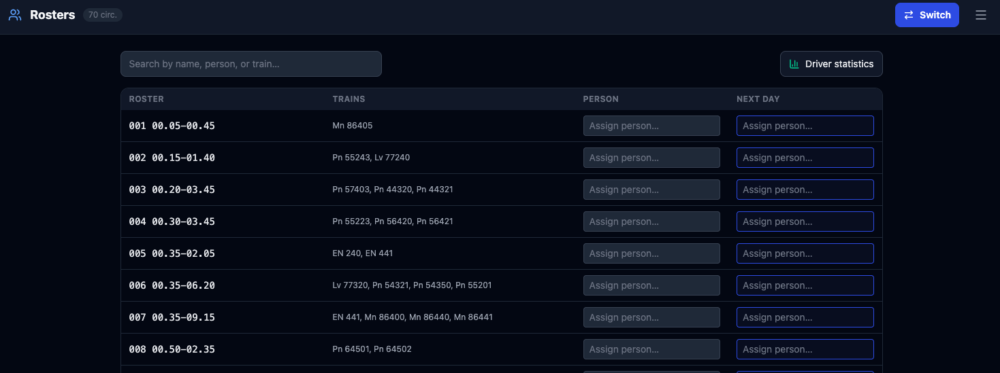
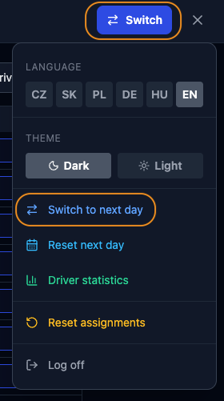
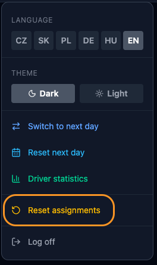
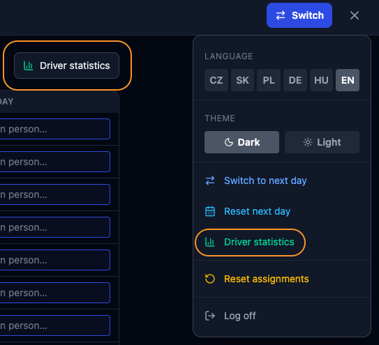
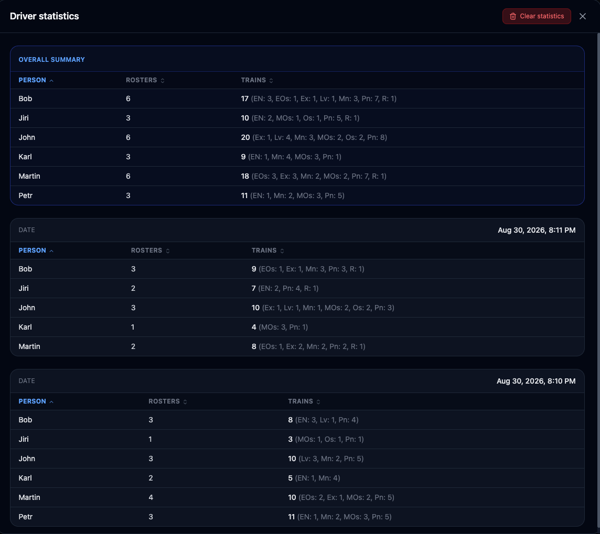

# DD-MB - Rosters

---

- [English (EN)](#english)
- [Čeština (CZ)](#čeština)
- [Slovenčina (SK)](#slovenčina)
- [Polski (PL)](#polski)
- [Deutsch (DE)](#deutsch)
- [Magyar (HU)](#magyar)

---

---

## English

This document describes how to use the **Rosters** feature of DD-MB. Rosters are an optional feature for digitally tracking which driver is assigned to which train. When Rosters are in use, every dispatcher can see driver assignments directly in their view.

### Step 1 — Import Circulations

Before using Rosters, import the rosters SVG export file in the admin portal (see **INITIAL_SETUP.md**, Step 5). This populates the Rosters with all circulations and their associated trains.

### Step 2 — Assigning a Driver

The *Rosters Manager* (the person responsible for managing assignments) opens the Rosters view. Each roster row shows the roster name, the trains it contains, the currently assigned driver, and the driver pre-assignment for the next model day.

To assign a driver, type the driver's name into the **Person** field and press Enter or click away. The assignment is saved immediately. Dispatchers will see the assignment on the relevant trains right away. The autosuggest function speeds up entry for drivers already assigned to other rosters or used on a previous model day.

### Step 3 — Preparing the Next Model Day

At the end of a model day there may be a situation where the layout still needs to be finished but rosters should already be prepared for the next "round". For this there is the **Next Day** column. The Rosters Manager can pre-assign drivers there in advance, and then switch those pre-assignments to the current day at model "midnight".

Switching is done via the **Switch to next day** option in the burger menu.

After switching, the **Next Day** column is cleared and ready for the following day's preparation.

### Step 4 — Resetting Assignments

If you need to clear the current day's assignments without saving them to statistics, use **Reset assignments** from the burger menu. To clear only the next-day pre-assignments without switching, use **Reset next day** from the burger menu.

### Step 5 — Driver Statistics

Each time you switch to a new day (Step 3), the current assignments are automatically saved to driver statistics. Statistics can be viewed by clicking the **Driver statistics** button directly in the view or via the burger menu.

The statistics panel contains two types of tables:

- **Overall** — aggregates data from all recorded days.
- **Per Day** — one table per recorded day, newest first.

In each table you can sort data by **Person**, **Rosters** (number of circulations), or **Trains** (total trains driven). The Trains column also shows a per-type breakdown (e.g. `12 (Ex: 4, Os: 5, R: 3)`).

To delete all recorded statistics, click the **Clear statistics** button inside the statistics panel.

---

---

## Čeština

Tento dokument popisuje, jak používat funkci **Turnusy** v DD-MB. Turnusy jsou volitelnou funkcí pro digitální sledování toho, který strojvedoucí je přiřazen ke kterému vlaku. Pokud jsou Turnusy používány, každý výpravčí vidí přiřazení strojvedoucích přímo ve svém zobrazení.

### Krok 1 — Import oběhů

Před použitím Turnusů importujte soubor s SVG exportem turnusů v administrátorském portálu (viz **INITIAL_SETUP.md**, Krok 5). Tím se Turnusy naplní všemi oběhy a jejich vlaky.

### Krok 2 — Přiřazení strojvedoucího

*Správce turnusů* (osoba zodpovědná za správu přiřazení) otevře zobrazení Turnusů. Každý řádek turnusu zobrazuje název turnusu, vlaky, které obsahuje, aktuálně přiřazeného strojvedoucího a předzadaného strojvedoucího pro příští modelový den.

Pro přiřazení strojvedoucího zadejte jeho jméno do pole **Osoba** a stiskněte Enter nebo klikněte mimo pole. Přiřazení je uloženo okamžitě. Výpravčí uvidí přiřazení u příslušných vlaků ihned. Funkce automatického doplňování usnadňuje zadávání jmen strojvedoucích, kteří jsou již přiřazeni k jiným turnusům nebo byli použiti v předchozím modelovém dni.

### Krok 3 — Příprava dalšího modelového dne

Na konci modelového dne může nastat situace, kdy rozložení ještě potřebuje být dokončeno, ale turnusy by již měly být připraveny pro další „kolo". K tomu slouží sloupec **Příští den**. Správce turnusů může strojvedoucí předzadat předem a při modelové „půlnoci" tato přednastavení přepnout na aktuální den.

Přepnutí se provádí přes možnost **Přepnout na nový den** v hamburger menu.

Po přepnutí je sloupec **Příští den** vymazán a připraven k přípravě následujícího dne.

### Krok 4 — Resetování přiřazení

Pokud potřebujete vymazat přiřazení aktuálního dne bez uložení do statistik, použijte možnost **Resetovat přiřazení** z hamburger menu. Pro vymazání pouze předzadání příštího dne bez přepnutí použijte **Resetovat příští den** z hamburger menu.

### Krok 5 — Statistiky strojvedoucích

Pokaždé, když přepnete na nový den (Krok 3), jsou aktuální přiřazení automaticky uložena do statistik strojvedoucích. Statistiky lze zobrazit kliknutím na tlačítko **Statistiky dispečerů** přímo v zobrazení nebo přes hamburger menu.

Panel statistik obsahuje dva typy tabulek:

- **Celkový přehled** — agreguje data ze všech zaznamenaných dnů.
- **Podle dne** — jedna tabulka na zaznamenaný den, nejnovější první.

V každé tabulce lze data seřadit podle **Osoby**, **Turnusů** (počet oběhů) nebo **Vlaků** (celkový počet odřízených vlaků). Sloupec Vlaky zobrazuje také rozpad podle typu (např. `12 (Ex: 4, Os: 5, R: 3)`).

Pro smazání všech zaznamenaných statistik klikněte na tlačítko **Smazat statistiky** uvnitř panelu statistik.

---

---

## Slovenčina

Tento dokument opisuje, ako používať funkciu **Turnusy** v DD-MB. Turnusy sú voliteľnou funkciou pre digitálne sledovanie toho, ktorý rušňovodič je priradený ku ktorému vlaku. Ak sú Turnusy používané, každý výpravca vidí priradenia rušňovodičov priamo vo svojom zobrazení.

### Krok 1 — Import obehov

Pred použitím Turnusov importujte súbor s SVG exportom turnusov v administrátorskom portáli (pozri **INITIAL_SETUP.md**, Krok 5). Tým sa Turnusy naplnia všetkými obehmi a ich vlakmi.

### Krok 2 — Priradenie rušňovodiča

*Správca turnusov* (osoba zodpovedná za správu priradení) otvorí zobrazenie Turnusov. Každý riadok turnusu zobrazuje názov turnusu, vlaky, ktoré obsahuje, aktuálne priradeného rušňovodiča a predbežné priradenie pre ďalší modelový deň.

Pre priradenie rušňovodiča zadajte jeho meno do poľa **Osoba** a stlačte Enter alebo kliknite mimo poľa. Priradenie sa uloží okamžite. Výpravcovia uvidia priradenie pri príslušných vlakoch hneď. Funkcia automatického dopĺňania urýchľuje zadávanie mien rušňovodičov, ktorí sú už priradení k iným turnusom alebo boli použití v predchádzajúcom modelovom dni.

### Krok 3 — Príprava ďalšieho modelového dňa

Na konci modelového dňa môže nastať situácia, keď rozloženie ešte treba dokončiť, ale turnusy by už mali byť pripravené pre ďalšie „kolo". Na to slúži stĺpec **Ďalší deň**. Správca turnusov môže rušňovodičov predbežne zadať vopred a pri modelovej „polnoci" tieto prednastavenia prepnúť na aktuálny deň.

Prepnutie sa vykoná cez možnosť **Prepnúť na nový deň** v hamburger menu.

Po prepnutí je stĺpec **Ďalší deň** vymazaný a pripravený na prípravu nasledujúceho dňa.

### Krok 4 — Resetovanie priradení

Ak potrebujete vymazať priradenia aktuálneho dňa bez uloženia do štatistík, použite možnosť **Resetovať priradenia** z hamburger menu. Na vymazanie iba predbežných priradení ďalšieho dňa bez prepnutia použite **Resetovať ďalší deň** z hamburger menu.

### Krok 5 — Štatistiky rušňovodičov

Zakaždým, keď prepnete na nový deň (Krok 3), sa aktuálne priradenia automaticky uložia do štatistík rušňovodičov. Štatistiky možno zobraziť kliknutím na tlačidlo **Štatistiky dispečerov** priamo v zobrazení alebo cez hamburger menu.

Panel štatistík obsahuje dva typy tabuliek:

- **Celkový prehľad** — agreguje dáta zo všetkých zaznamenaných dní.
- **Podľa dňa** — jedna tabuľka na zaznamenaný deň, najnovšia prvá.

V každej tabuľke možno dáta zoradiť podľa **Osoby**, **Turnusov** (počet obehov) alebo **Vlakov** (celkový počet vedených vlakov). Stĺpec Vlaky zobrazuje aj rozpad podľa typu (napr. `12 (Ex: 4, Os: 5, R: 3)`).

Na zmazanie všetkých zaznamenaných štatistík kliknite na tlačidlo **Zmazať štatistiky** v paneli štatistík.

---

---

## Polski

Niniejszy dokument opisuje, jak korzystać z funkcji **Turnus** w DD-MB. Turnusy to opcjonalna funkcja do cyfrowego śledzenia, który maszynista jest przypisany do którego pociągu. Gdy Turnusy są w użyciu, każdy dyżurny widzi przypisania maszynistów bezpośrednio w swoim widoku.

### Krok 1 — Import obiegów

Przed użyciem Turnusów zaimportuj plik eksportu SVG turnusów w portalu administratora (patrz **INITIAL_SETUP.md**, Krok 5). Spowoduje to wypełnienie Turnusów wszystkimi obiegami i ich pociągami.

### Krok 2 — Przypisanie maszynisty

*Menedżer turnusów* (osoba odpowiedzialna za zarządzanie przypisaniami) otwiera widok Turnusów. Każdy wiersz turnusu pokazuje nazwę turnusu, pociągi, które zawiera, aktualnie przypisanego maszynistę oraz wstępne przypisanie na następny dzień modelowy.

Aby przypisać maszynistę, wpisz jego imię i nazwisko w pole **Osoba** i naciśnij Enter lub kliknij poza polem. Przypisanie zostaje zapisane natychmiast. Dyżurni zobaczą przypisanie przy odpowiednich pociągach od razu. Funkcja automatycznego uzupełniania przyspiesza wprowadzanie danych dla maszynistów już przypisanych do innych turnusów lub używanych w poprzednim dniu modelowym.

### Krok 3 — Przygotowanie następnego dnia modelowego

Pod koniec dnia modelowego może zaistnieć sytuacja, gdy układ musi jeszcze zostać ukończony, ale turnusy powinny być już przygotowane na kolejną „rundę". Do tego służy kolumna **Następny dzień**. Menedżer turnusów może wstępnie przypisać maszynistów z wyprzedzeniem, a przy modelowej „północy" przełączyć te wstępne przypisania na bieżący dzień.

Przełączenie odbywa się przez opcję **Przełącz na nowy dzień** w menu hamburger.

Po przełączeniu kolumna **Następny dzień** jest czyszczona i gotowa do przygotowania kolejnego dnia.

### Krok 4 — Resetowanie przypisań

Jeśli musisz wyczyścić przypisania bieżącego dnia bez zapisywania ich do statystyk, użyj opcji **Resetuj przypisania** z menu hamburger. Aby wyczyścić tylko wstępne przypisania następnego dnia bez przełączania, użyj **Resetuj następny dzień** z menu hamburger.

### Krok 5 — Statystyki maszynistów

Za każdym razem, gdy przełączasz się na nowy dzień (Krok 3), bieżące przypisania są automatycznie zapisywane do statystyk maszynistów. Statystyki można wyświetlić, klikając przycisk **Statystyki dyspozytorów** bezpośrednio w widoku lub przez menu hamburger.

Panel statystyk zawiera dwa typy tabel:

- **Zestawienie ogólne** — agreguje dane ze wszystkich zarejestrowanych dni.
- **Według dnia** — jedna tabela na zarejestrowany dzień, najnowsza pierwsza.

W każdej tabeli można sortować dane według **Osoby**, **Turnusów** (liczba obiegów) lub **Pociągów** (łączna liczba poprowadzonych pociągów). Kolumna Pociągi wyświetla również podział według typu (np. `12 (Ex: 4, Os: 5, R: 3)`).

Aby usunąć wszystkie zarejestrowane statystyki, kliknij przycisk **Usuń statystyki** wewnątrz panelu statystyk.

---

---

## Deutsch

Dieses Dokument beschreibt die Verwendung der **Turnusse**-Funktion in DD-MB. Turnusse sind eine optionale Funktion zur digitalen Verfolgung, welcher Triebfahrzeugführer welchem Zug zugewiesen ist. Wenn Turnusse verwendet werden, sehen alle Fahrdienstleiter die Triebfahrzeugführer-Zuweisungen direkt in ihrer Ansicht.

### Schritt 1 — Umläufe importieren

Importieren Sie vor der Verwendung von Turnussen die SVG-Exportdatei der Turnusse im Admin-Portal (siehe **INITIAL_SETUP.md**, Schritt 5). Dadurch werden die Turnusse mit allen Umläufen und den zugehörigen Zügen befüllt.

### Schritt 2 — Triebfahrzeugführer zuweisen

Der *Turnusmanager* (die Person, die für die Verwaltung der Zuweisungen zuständig ist) öffnet die Turnuss-Ansicht. Jede Turnuss-Zeile zeigt den Turnuss-Namen, die enthaltenen Züge, den aktuell zugewiesenen Triebfahrzeugführer sowie die Voraus-Zuweisung für den nächsten Modelltag.

Um einen Triebfahrzeugführer zuzuweisen, geben Sie seinen Namen in das Feld **Person** ein und drücken Sie Enter oder klicken Sie außerhalb des Feldes. Die Zuweisung wird sofort gespeichert. Die Fahrdienstleiter sehen die Zuweisung bei den betreffenden Zügen unmittelbar. Die Autovervollständigung beschleunigt die Eingabe für Triebfahrzeugführer, die bereits anderen Turnussen zugewiesen sind oder am vorherigen Modelltag verwendet wurden.

### Schritt 3 — Vorbereitung des nächsten Modelltages

Am Ende eines Modelltages kann es vorkommen, dass die Anlage noch fertiggestellt werden muss, die Turnusse aber bereits für die nächste „Runde" vorbereitet werden sollen. Dafür gibt es die Spalte **Nächster Tag**. Der Turnusmanager kann Triebfahrzeugführer dort im Voraus zuweisen und diese Voraus-Zuweisungen bei der Modell-„Mitternacht" auf den aktuellen Tag umschalten.

Das Umschalten erfolgt über die Option **Auf nächsten Tag umschalten** im Burger-Menü.

Nach dem Umschalten wird die Spalte **Nächster Tag** geleert und ist für die Vorbereitung des folgenden Tages bereit.

### Schritt 4 — Zuweisungen zurücksetzen

Wenn Sie die Zuweisungen des aktuellen Tages löschen müssen, ohne sie in der Statistik zu speichern, verwenden Sie **Zuweisungen zurücksetzen** aus dem Burger-Menü. Um nur die Voraus-Zuweisungen des nächsten Tages ohne Umschalten zu löschen, verwenden Sie **Nächsten Tag zurücksetzen** aus dem Burger-Menü.

### Schritt 5 — Fahrerstatistiken

Jedes Mal, wenn Sie auf einen neuen Tag umschalten (Schritt 3), werden die aktuellen Zuweisungen automatisch in der Fahrerstatistik gespeichert. Die Statistiken können durch Klicken auf die Schaltfläche **Fahrerstatistiken** direkt in der Ansicht oder über das Burger-Menü aufgerufen werden.

Das Statistikfenster enthält zwei Tabellentypen:

- **Gesamtübersicht** — aggregiert Daten aus allen aufgezeichneten Tagen.
- **Nach Tag** — eine Tabelle pro aufgezeichnetem Tag, neueste zuerst.

In jeder Tabelle können die Daten nach **Person**, **Turnusse** (Anzahl der Umläufe) oder **Züge** (Gesamtzahl der gefahrenen Züge) sortiert werden. Die Spalte Züge zeigt auch eine Aufschlüsselung nach Typ (z. B. `12 (Ex: 4, Os: 5, R: 3)`).

Um alle aufgezeichneten Statistiken zu löschen, klicken Sie im Statistikfenster auf die Schaltfläche **Statistiken löschen**.

---

---

## Magyar

Ez a dokumentum leírja a **Turnusok** funkció használatát a DD-MB rendszerben. A Turnusok egy opcionális funkció a mozdonyvezető-beosztások digitális nyilvántartásához. Ha a Turnusok használatban vannak, minden forgalomirányító közvetlenül a saját nézetében látja a mozdonyvezetők beosztásait.

### 1. lépés — Körök importálása

A Turnusok használata előtt importálja a turnusok SVG-exportfájlját az adminisztrátori portálon (lásd **INITIAL_SETUP.md**, 5. lépés). Ezzel a Turnusok feltöltődnek az összes körrel és az azokhoz tartozó vonatokkal.

### 2. lépés — Mozdonyvezető hozzárendelése

A *Turnuskezelő* (a beosztások kezeléséért felelős személy) megnyitja a Turnusok nézetet. Minden turnussor mutatja a turnusnevet, a benne szereplő vonatokat, az aktuálisan hozzárendelt mozdonyvezetőt és a következő modelnapra szóló előzetes hozzárendelést.

Mozdonyvezető hozzárendeléséhez írja be a nevét a **Személy** mezőbe, majd nyomja meg az Entert vagy kattintson a mezőn kívülre. A hozzárendelés azonnal mentésre kerül. A forgalomirányítók azonnal látják a beosztást az érintett vonatoknál. Az automatikus kiegészítés funkció felgyorsítja az adatbevitelt a más turnusokhoz már hozzárendelt vagy egy korábbi modelnapon használt mozdonyvezetők esetén.

### 3. lépés — A következő modelnap előkészítése

A modelnap végén előfordulhat, hogy az elrendezést még be kell fejezni, de a turnusokat már elő kell készíteni a következő „körre". Erre szolgál a **Következő nap** oszlop. A Turnuskezelő előre hozzárendelheti a mozdonyvezetőket, majd a modell „éjfélkor" átválthatja ezeket az előzetes hozzárendeléseket az aktuális napra.

Az átváltás a hamburger menü **Váltás a következő napra** lehetőségével történik.

Az átváltás után a **Következő nap** oszlop kiürül, és készen áll a következő nap előkészítésére.

### 4. lépés — Hozzárendelések visszaállítása

Ha az aktuális nap hozzárendeléseit a statisztikába mentés nélkül kell törölni, használja a hamburger menü **Beosztások visszaállítása** lehetőségét. Ha csak a következő nap előzetes hozzárendeléseit szeretné törölni átváltás nélkül, használja a **Következő nap visszaállítása** lehetőséget a hamburger menüből.

### 5. lépés — Sofőrstatisztikák

Minden alkalommal, amikor új napra vált (3. lépés), az aktuális hozzárendelések automatikusan mentésre kerülnek a sofőrstatisztikákba. A statisztikák megtekinthetők a nézetben közvetlenül a **Sofőrstatisztikák** gombra kattintva, vagy a hamburger menün keresztül.

A statisztikai panel kétféle táblázatot tartalmaz:

- **Összesített áttekintés** — az összes rögzített nap adatait összesíti.
- **Naponként** — egy táblázat rögzített naponként, a legújabb elöl.

Minden táblázatban az adatok rendezhetők **Személy**, **Turnuszok** (körök száma) vagy **Vonatok** (összes vezetett vonat száma) szerint. A Vonatok oszlop típusonkénti bontást is mutat (pl. `12 (Ex: 4, Os: 5, R: 3)`).

Az összes rögzített statisztika törléséhez kattintson a statisztikai panelen belül a **Statisztikák törlése** gombra.

