# DD-MB - Simplified End Station

---

- [English (EN)](#english)
- [Čeština (CZ)](#čeština)
- [Slovenčina (SK)](#slovenčina)
- [Polski (PL)](#polski)
- [Deutsch (DE)](#deutsch)
- [Magyar (HU)](#magyar)

---

## English

### Table of Contents

- [Basic View](#basic-view)
- [Basic Concept](#basic-concept)
- [Multiple Simultaneous Trains](#multiple-simultaneous-trains)
- [Retracting an Offer](#retracting-an-offer)
- [Rejected Offers](#rejected-offers)
- [Train Notes and Freight Information](#train-notes-and-freight-information)
- [Adding an Extra Train](#adding-an-extra-train)
- [Removing a Train](#removing-a-train)

---

### Basic View

The screenshot below shows the default simplified view in DD-MB. Its main purpose is to "semi-automate" the dispatcher by leaving the offering and accepting of trains directly to drivers, while keeping the interface as simple as possible and requiring no deep knowledge of DD-MB.

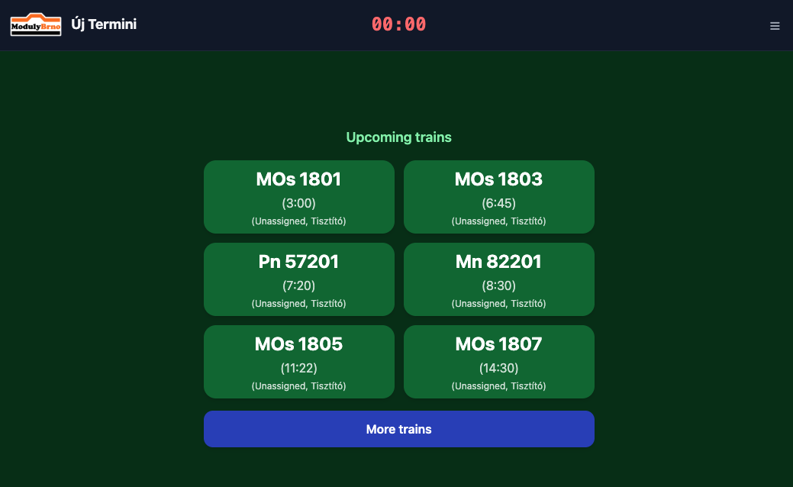

The burger menu contains:

- A setting to display multiple languages at once (e.g. for international meetings).
- A theme selector (dark/light).
- Display assignments — shows the assigned driver next to each train.
- Display next station — shows each train's next destination.
- Add extra train (only available while no train is active at the station).
- Logoff.

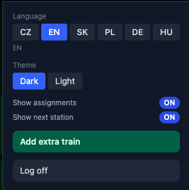

### Basic Concept

By default, the next six upcoming trains are displayed. If the driver needs to drive a different train, the "More trains" button loads the next six. Once more trains are loaded, "To start" and "Back" buttons appear to navigate between the pages.

When the driver picks up a train, they tap it, which offers the train to the adjacent station. The display turns orange, and the driver must wait until the adjacent station accepts the offer.

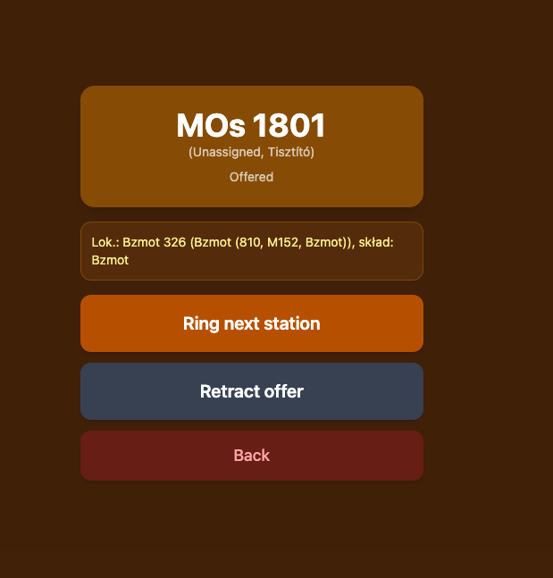

To prompt a faster response, the driver can "ring" the adjacent station.

Once the offer is accepted, the driver can confirm departure and get underway.

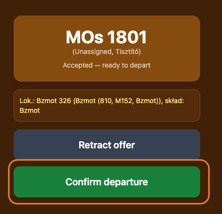

After departure is confirmed, the block is set to occupied and the display turns red. At this point, no other driver can do anything until the block is freed again.

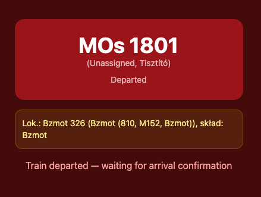

When a train is offered from an adjacent station, the offer is automatically accepted and the block is set to occupied. While this block is occupied, no new train can be assigned to it (unless the section has multiple parallel blocks configured). Once the driver arrives, they must confirm arrival to free the block.

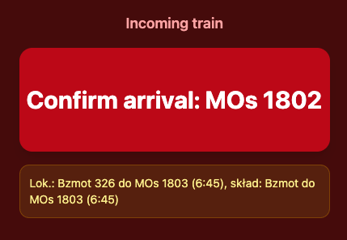

Once arrival is confirmed, the train remains assigned to the layout. There may still be an action for the driver to perform (e.g. attaching/detaching wagons) before the train can continue. If the station is the end of the line, the driver can also "ring" any adjacent station except the one the train just arrived from (since that station already knows the train has arrived) — this is a general alert to that neighboring station, independent of this particular train. Once everything is done, the driver must confirm that the circulation has ended, which switches the display back to the basic view.

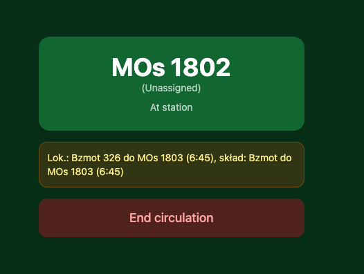

### Multiple Simultaneous Trains

If the section between the station and its neighbor is configured with more than one parallel block (track), the station can handle more than one active train at the same time. In that case, as soon as a block slot is still free, the panel below the active train card switches to "Add another train" instead of returning to the plain upcoming-trains screen, letting the driver pick up a second train without waiting for the first one to depart.

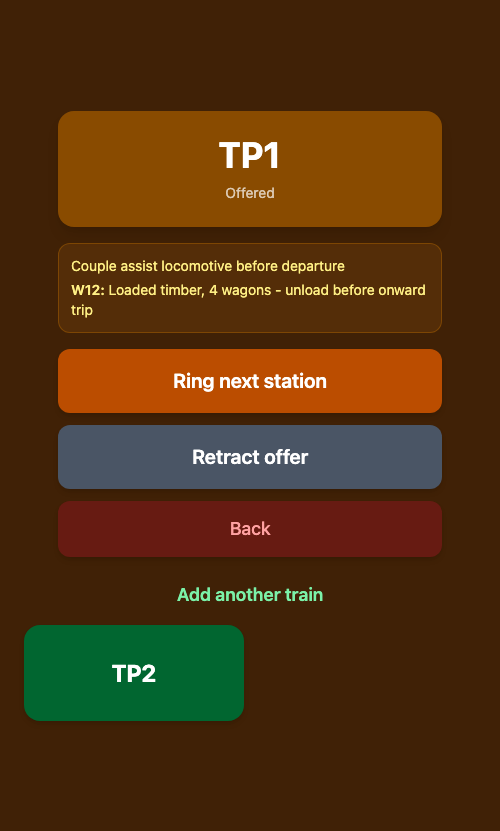

### Retracting an Offer

If a train was offered (or already accepted) by mistake, or the situation changes before departure, the driver can tap "Retract offer" to cancel it. The train returns to "At station", and the regular offer button reappears so it can be offered again later.

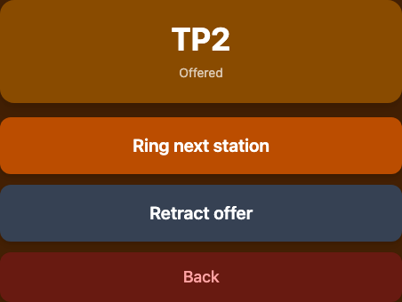

### Rejected Offers

The adjacent station is not obliged to accept an offered train — for example, if its platform is occupied or a higher-priority train is expected. If the offer is rejected, the train returns to "At station" at the originating station, and the reason for rejection (together with the name of the rejecting station) is shown directly on the train's card so the driver knows why the train didn't depart.

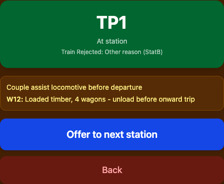

### Train Notes and Freight Information

If a train carries notes (e.g. special handling instructions) or freight/wagon information, it is displayed in a highlighted box under the train's status. This is the "attaching/detaching wagons, etc." action mentioned above — the driver should check this box for anything that needs to be done before the train can continue.

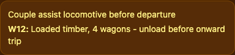

### Adding an Extra Train

When no train is active at the station, the burger menu offers "Add extra train" for unplanned/ad-hoc movements that aren't part of the timetable. The driver only needs to enter the train's number.

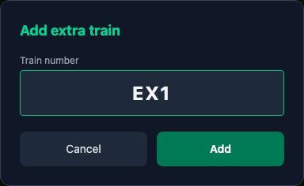

Since an extra train has no predefined destination, once it is added the driver is offered a button for each adjacent station instead of a single "Offer to next station" button, and can choose where to send it.

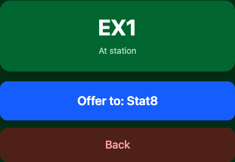

### Removing a Train

A train can be removed from the active panel before it finishes its journey, for example if it was added by mistake. The exact behavior depends on where the train currently is:

- At its originating station (where it started, with nothing offered yet or still only offered — not yet accepted) — tapping "Back" undoes it immediately, no confirmation needed, since no other station has committed to the train yet.
- At the end-of-line station — tapping "End circulation" removes the train permanently, since its journey is complete.
- At any other (pass-through) station — tapping "Remove train" asks for confirmation first, since the train is already part of an active working between two stations.

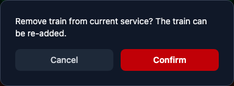

---

## Čeština

### Obsah

- [Základní zobrazení](#základní-zobrazení)
- [Základní koncept](#základní-koncept)
- [Více souběžných vlaků](#více-souběžných-vlaků)
- [Stažení nabídky](#stažení-nabídky)
- [Odmítnuté nabídky](#odmítnuté-nabídky)
- [Poznámky k vlaku a informace o nákladu](#poznámky-k-vlaku-a-informace-o-nákladu)
- [Přidání mimořádného vlaku](#přidání-mimořádného-vlaku)
- [Odebrání vlaku](#odebrání-vlaku)

---

### Základní zobrazení

Snímek obrazovky níže ukazuje výchozí zjednodušené zobrazení v DD-MB. Jeho hlavním účelem je „poloautomatizovat" výpravčího tím, že nabízení a přijímání vlaků nechá přímo na strojvedoucích, zatímco rozhraní zůstává co nejjednodušší a nevyžaduje hlubokou znalost DD-MB.

Burger menu obsahuje:

- Nastavení pro zobrazení více jazyků najednou (např. pro mezinárodní setkání).
- Výběr motivu (tmavý/světlý).
- Zobrazit přiřazení — zobrazuje přiřazeného strojvedoucího u každého vlaku.
- Zobrazit další stanici — zobrazuje příští cílovou stanici každého vlaku.
- Přidat vlak navíc (dostupné pouze pokud ve stanici není aktivní žádný vlak).
- Odhlásit.

### Základní koncept

Ve výchozím stavu se zobrazuje následujících šest vlaků. Pokud má strojvedoucí řídit jiný vlak, tlačítko „Další vlaky" načte dalších šest. Jakmile jsou načteny další vlaky, objeví se tlačítka „Na začátek" a „Zpět" pro procházení mezi stránkami.

Když si strojvedoucí vlak převezme, klepne na něj, čímž vlak nabídne sousední stanici. Zobrazení se zbarví oranžově a strojvedoucí musí počkat, až sousední stanice nabídku přijme.

Pro urychlení reakce může strojvedoucí sousední stanici „zazvonit".

Jakmile je nabídka přijata, strojvedoucí může potvrdit odjezd a vyrazit.

Po potvrzení odjezdu se blok nastaví jako obsazený a zobrazení se zbarví červeně. V tuto chvíli nemůže žádný jiný strojvedoucí nic dělat, dokud se blok znovu neuvolní.

Pokud je vlak nabídnut ze sousední stanice, nabídka je automaticky přijata a blok se nastaví jako obsazený. Dokud je tento blok obsazen, nelze mu přiřadit žádný nový vlak (pokud úsek nemá nakonfigurováno více paralelních bloků). Jakmile strojvedoucí dorazí, musí potvrdit příjezd, aby se blok uvolnil.

Po potvrzení příjezdu zůstává vlak v layoutu. Může ještě zbývat nějaká akce, kterou musí strojvedoucí provést (např. připojení/odpojení vozů), než může vlak pokračovat. Pokud je stanice koncem trati, může strojvedoucí také „zazvonit" do libovolné sousední stanice kromě té, ze které vlak právě dorazil (ta už totiž ví, že vlak dorazil) — jedná se o obecné upozornění této sousední stanici, nezávislé na tomto konkrétním vlaku. Jakmile je vše hotovo, strojvedoucí musí potvrdit, že oběh skončil, čímž se zobrazení vrátí do základního stavu.

### Více souběžných vlaků

Pokud je úsek mezi stanicí a jejím sousedem nakonfigurován s více paralelními bloky (kolejemi), může stanice zároveň obsluhovat více než jeden aktivní vlak. V takovém případě se panel pod kartou aktivního vlaku, dokud je ještě volný slot bloku, přepne na „Přidat další vlak" místo návratu na prosté zobrazení následujících vlaků, což umožní strojvedoucímu převzít druhý vlak, aniž by musel čekat na odjezd prvního.

### Stažení nabídky

Pokud byl vlak nabídnut (nebo dokonce již přijat) omylem, nebo se situace před odjezdem změní, může strojvedoucí klepnutím na „Stáhnout nabídku" nabídku zrušit. Vlak se vrátí do stavu „Ve stanici" a znovu se objeví běžné tlačítko pro nabídku, aby mohl být později nabídnut znovu.

### Odmítnuté nabídky

Sousední stanice není povinna nabídnutý vlak přijmout — například pokud je její nástupiště obsazené nebo je očekáván vlak s vyšší prioritou. Pokud je nabídka odmítnuta, vlak se vrátí do stavu „Ve stanici" na výchozí stanici a přímo na kartě vlaku se zobrazí důvod odmítnutí (spolu s názvem odmítající stanice), aby strojvedoucí věděl, proč vlak neodjel.

### Poznámky k vlaku a informace o nákladu

Pokud má vlak poznámky (např. zvláštní pokyny pro manipulaci) nebo informace o nákladu/vozech, zobrazí se ve zvýrazněném rámečku pod stavem vlaku. Jedná se o zmíněnou akci „připojení/odpojení vozů atd." — strojvedoucí by měl tento rámeček zkontrolovat kvůli čemukoli, co je potřeba udělat, než může vlak pokračovat.

### Přidání mimořádného vlaku

Pokud ve stanici není aktivní žádný vlak, nabízí burger menu položku „Přidat vlak navíc" pro neplánované/ad-hoc jízdy, které nejsou součástí jízdního řádu. Strojvedoucí stačí zadat číslo vlaku.

Protože mimořádný vlak nemá předem určený cíl, po jeho přidání je strojvedoucímu místo jediného tlačítka „Nabídnout do sousední stanice" nabídnuto tlačítko pro každou sousední stanici, takže si může vybrat, kam vlak poslat.

### Odebrání vlaku

Vlak lze z panelu aktivních vlaků odebrat ještě předtím, než dokončí svou jízdu, například pokud byl přidán omylem. Konkrétní chování závisí na tom, kde se vlak právě nachází:

- Na výchozí stanici (kde jízda začala, s dosud nenabídnutým vlakem nebo pouze nabídnutým — ještě nepřijatým) — klepnutím na „Zpět" se akce okamžitě vrátí bez nutnosti potvrzení, protože se k vlaku zatím nezavázala žádná jiná stanice.
- Na konečné stanici — klepnutím na „Ukončit oběh" se vlak natrvalo odebere, protože jeho jízda je u konce.
- Na jakékoli jiné (průjezdné) stanici — klepnutí na „Odebrat vlak" si vyžádá potvrzení, protože vlak je již součástí aktivní jízdy mezi dvěma stanicemi.

---

## Slovenčina

### Obsah

- [Základné zobrazenie](#základné-zobrazenie)
- [Základný koncept](#základný-koncept)
- [Viacero súbežných vlakov](#viacero-súbežných-vlakov)
- [Stiahnutie ponuky](#stiahnutie-ponuky)
- [Odmietnuté ponuky](#odmietnuté-ponuky)
- [Poznámky k vlaku a informácie o náklade](#poznámky-k-vlaku-a-informácie-o-náklade)
- [Pridanie mimoriadneho vlaku](#pridanie-mimoriadneho-vlaku)
- [Odobratie vlaku](#odobratie-vlaku)

---

### Základné zobrazenie

Snímka obrazovky nižšie zobrazuje predvolené zjednodušené zobrazenie v DD-MB. Jeho hlavným účelom je „poloautomatizovať" výpravcu tak, že ponúkanie a prijímanie vlakov necháva priamo na rušňovodičoch, pričom rozhranie zostáva čo najjednoduchšie a nevyžaduje hlbokú znalosť DD-MB.

Burger menu obsahuje:

- Nastavenie na zobrazenie viacerých jazykov naraz (napr. pre medzinárodné stretnutia).
- Výber motívu (tmavý/svetlý).
- Zobraziť priradenia — zobrazuje priradeného rušňovodiča pri každom vlaku.
- Zobraziť ďalšiu stanicu — zobrazuje ďalšiu cieľovú stanicu každého vlaku.
- Pridať vlak navyše (dostupné iba ak v stanici nie je aktívny žiadny vlak).
- Odhlásiť.

### Základný koncept

V predvolenom stave sa zobrazuje nasledujúcich šesť vlakov. Ak musí rušňovodič viesť iný vlak, tlačidlo „Ďalšie vlaky" načíta ďalších šesť. Po načítaní ďalších vlakov sa zobrazia tlačidlá „Na začiatok" a „Späť" na prechádzanie medzi stránkami.

Keď si rušňovodič vlak preberie, klepne naň, čím sa vlak ponúkne susednej stanici. Zobrazenie sa zafarbí oranžovo a rušňovodič musí počkať, kým susedná stanica ponuku prijme.

Na urýchlenie reakcie môže rušňovodič susednú stanicu „zazvoniť".

Po prijatí ponuky môže rušňovodič potvrdiť odchod a vyraziť.

Po potvrdení odchodu sa blok nastaví ako obsadený a zobrazenie sa zafarbí červeno. V tejto chvíli nemôže žiadny iný rušňovodič nič robiť, kým sa blok znova neuvoľní.

Ak je vlak ponúknutý zo susednej stanice, ponuka sa automaticky prijme a blok sa nastaví ako obsadený. Kým je tento blok obsadený, nemožno mu priradiť žiadny nový vlak (pokiaľ úsek nemá nakonfigurovaných viac paralelných blokov). Keď rušňovodič dorazí, musí potvrdiť príchod, aby sa blok uvoľnil.

Po potvrdení príchodu zostáva vlak priradený k rozloženiu. Môže ešte zostávať nejaká akcia, ktorú musí rušňovodič vykonať (napr. pripojenie/odpojenie vozňov), kým môže vlak pokračovať. Ak je stanica koncom trate, rušňovodič môže tiež „zazvoniť" do ľubovoľnej susednej stanice okrem tej, z ktorej vlak práve dorazil (tá už totiž vie, že vlak dorazil) — ide o všeobecné upozornenie tejto susednej stanici, nezávislé od tohto konkrétneho vlaku. Keď je všetko hotové, rušňovodič musí potvrdiť, že obeh skončil, čím sa zobrazenie vráti do základného stavu.

### Viacero súbežných vlakov

Ak je úsek medzi stanicou a jej susedom nakonfigurovaný s viacerými paralelnými blokmi (koľajami), stanica môže súčasne obsluhovať viac ako jeden aktívny vlak. V takom prípade sa panel pod kartou aktívneho vlaku, kým je ešte voľný slot bloku, prepne na „Pridať ďalší vlak" namiesto návratu na obyčajné zobrazenie nasledujúcich vlakov, čo umožní rušňovodičovi prevziať druhý vlak bez čakania na odchod prvého.

### Stiahnutie ponuky

Ak bol vlak ponúknutý (alebo dokonca už prijatý) omylom, alebo sa situácia pred odchodom zmení, môže rušňovodič klepnutím na „Stiahnuť ponuku" ponuku zrušiť. Vlak sa vráti do stavu „Na stanici" a znova sa objaví bežné tlačidlo na ponuku, aby mohol byť neskôr ponúknutý znova.

### Odmietnuté ponuky

Susedná stanica nie je povinná ponúknutý vlak prijať — napríklad ak je jej nástupište obsadené alebo sa očakáva vlak s vyššou prioritou. Ak je ponuka odmietnutá, vlak sa vráti do stavu „Na stanici" na výchozej stanici a priamo na karte vlaku sa zobrazí dôvod odmietnutia (spolu s názvom odmietajúcej stanice), aby rušňovodič vedel, prečo vlak neodišiel.

### Poznámky k vlaku a informácie o náklade

Ak má vlak poznámky (napr. osobitné pokyny na manipuláciu) alebo informácie o náklade/vozňoch, zobrazia sa v zvýraznenom rámčeku pod stavom vlaku. Ide o spomínanú akciu „pripojenie/odpojenie vozňov atď." — rušňovodič by mal tento rámček skontrolovať kvôli čomukoľvek, čo je potrebné urobiť, kým môže vlak pokračovať.

### Pridanie mimoriadneho vlaku

Ak v stanici nie je aktívny žiadny vlak, burger menu ponúka položku „Pridať vlak navyše" pre neplánované/ad-hoc jazdy, ktoré nie sú súčasťou cestovného poriadku. Rušňovodičovi stačí zadať číslo vlaku.

Keďže mimoriadny vlak nemá vopred určený cieľ, po jeho pridaní sa rušňovodičovi namiesto jediného tlačidla „Ponúknuť do susednej stanice" ponúkne tlačidlo pre každú susednú stanicu, takže si môže vybrať, kam vlak poslať.

### Odobratie vlaku

Vlak možno z panela aktívnych vlakov odobrať ešte predtým, než dokončí svoju jazdu, napríklad ak bol pridaný omylom. Konkrétne správanie závisí od toho, kde sa vlak práve nachádza:

- Na výchozej stanici (kde jazda začala, s doposiaľ neponúknutým vlakom alebo iba ponúknutým — ešte neprijatým) — klepnutím na „Späť" sa akcia okamžite vráti bez potreby potvrdenia, pretože sa k vlaku zatiaľ nezaviazala žiadna iná stanica.
- Na konečnej stanici — klepnutím na „Ukončiť obeh" sa vlak natrvalo odoberie, pretože jeho jazda je ukončená.
- Na akejkoľvek inej (prejazdnej) stanici — klepnutie na „Odstrániť vlak" si vyžiada potvrdenie, pretože vlak je už súčasťou aktívnej jazdy medzi dvoma stanicami.

---

## Polski

### Spis treści

- [Widok podstawowy](#widok-podstawowy)
- [Podstawowa koncepcja](#podstawowa-koncepcja)
- [Wiele jednoczesnych pociągów](#wiele-jednoczesnych-pociągów)
- [Wycofanie oferty](#wycofanie-oferty)
- [Odrzucone oferty](#odrzucone-oferty)
- [Uwagi do pociągu i informacje o ładunku](#uwagi-do-pociągu-i-informacje-o-ładunku)
- [Dodawanie dodatkowego pociągu](#dodawanie-dodatkowego-pociągu)
- [Usuwanie pociągu](#usuwanie-pociągu)

---

### Widok podstawowy

Poniższy zrzut ekranu przedstawia domyślny uproszczony widok w DD-MB. Jego głównym celem jest „półautomatyzacja" dyżurnego ruchu poprzez pozostawienie oferowania i przyjmowania pociągów bezpośrednio maszynistom, przy jednoczesnym zachowaniu jak najprostszego interfejsu, niewymagającego głębokiej znajomości DD-MB.

Menu hamburgera zawiera:

- Ustawienie wyświetlania wielu języków jednocześnie (np. na potrzeby spotkań międzynarodowych).
- Wybór motywu (ciemny/jasny).
- Pokaż przypisania — wyświetla przypisanego maszynistę przy każdym pociągu.
- Pokaż następną stację — wyświetla następny cel każdego pociągu.
- Dodaj dodatkowy pociąg (dostępne tylko wtedy, gdy na stacji nie ma aktywnego pociągu).
- Wyloguj.

### Podstawowa koncepcja

Domyślnie wyświetlanych jest kolejnych sześć pociągów. Jeśli maszynista musi prowadzić inny pociąg, przycisk „Więcej pociągów" wczytuje kolejnych sześć. Po wczytaniu kolejnych pociągów pojawiają się przyciski „Na początek" i „Wstecz" do nawigacji między stronami.

Gdy maszynista przejmuje pociąg, dotyka go, co powoduje zaoferowanie pociągu sąsiedniej stacji. Wyświetlacz zmienia kolor na pomarańczowy, a maszynista musi czekać, aż sąsiednia stacja zaakceptuje ofertę.

Aby przyspieszyć reakcję, maszynista może „zadzwonić" do sąsiedniej stacji.

Po zaakceptowaniu oferty maszynista może potwierdzić odjazd i ruszyć w drogę.

Po potwierdzeniu odjazdu blok zostaje ustawiony jako zajęty, a wyświetlacz zmienia kolor na czerwony. W tym momencie żaden inny maszynista nie może nic zrobić, dopóki blok nie zostanie ponownie zwolniony.

Gdy pociąg jest oferowany z sąsiedniej stacji, oferta jest automatycznie akceptowana, a blok zostaje ustawiony jako zajęty. Dopóki blok jest zajęty, nie można do niego przypisać nowego pociągu (chyba że odcinek ma skonfigurowanych kilka równoległych torów blokowych). Gdy maszynista przybędzie, musi potwierdzić przyjazd, aby zwolnić blok.

Po potwierdzeniu przyjazdu pociąg pozostaje przypisany do układu. Może nadal pozostać jakieś działanie do wykonania przez maszynistę (np. podłączenie/odłączenie wagonów), zanim pociąg będzie mógł kontynuować jazdę. Jeśli stacja jest końcem linii, maszynista może również „zadzwonić" do dowolnej sąsiedniej stacji, z wyjątkiem tej, z której pociąg właśnie przyjechał (ta stacja już wie, że pociąg przyjechał) — jest to ogólne powiadomienie tej sąsiedniej stacji, niezależne od tego konkretnego pociągu. Gdy wszystko zostanie wykonane, maszynista musi potwierdzić zakończenie kursu, co przełącza wyświetlacz z powrotem do widoku podstawowego.

### Wiele jednoczesnych pociągów

Jeśli odcinek między stacją a jej sąsiadem jest skonfigurowany z więcej niż jednym równoległym blokiem (torem), stacja może jednocześnie obsługiwać więcej niż jeden aktywny pociąg. W takim przypadku panel poniżej karty aktywnego pociągu, dopóki dostępny jest wolny slot bloku, przełącza się na „Dodaj kolejny pociąg" zamiast powrotu do zwykłego ekranu nadchodzących pociągów, co pozwala maszyniście przejąć drugi pociąg bez czekania na odjazd pierwszego.

### Wycofanie oferty

Jeśli pociąg został zaoferowany (lub nawet już zaakceptowany) przez pomyłkę, albo sytuacja zmienia się przed odjazdem, maszynista może dotknąć „Wycofaj ofertę", aby ją anulować. Pociąg wraca do stanu „Na stacji", a zwykły przycisk oferty pojawia się ponownie, aby można było zaoferować go ponownie później.

### Odrzucone oferty

Sąsiednia stacja nie ma obowiązku zaakceptować zaoferowanego pociągu — na przykład jeśli jej peron jest zajęty albo oczekiwany jest pociąg o wyższym priorytecie. Jeśli oferta zostanie odrzucona, pociąg wraca do stanu „Na stacji" na stacji początkowej, a bezpośrednio na karcie pociągu wyświetlany jest powód odrzucenia (wraz z nazwą odrzucającej stacji), aby maszynista wiedział, dlaczego pociąg nie odjechał.

### Uwagi do pociągu i informacje o ładunku

Jeśli pociąg zawiera uwagi (np. specjalne instrukcje dotyczące obsługi) lub informacje o ładunku/wagonach, są one wyświetlane w wyróżnionym polu pod stanem pociągu. Jest to wspomniane wcześniej działanie „podłączenie/odłączenie wagonów itp." — maszynista powinien sprawdzić to pole pod kątem wszystkiego, co należy zrobić, zanim pociąg będzie mógł kontynuować jazdę.

### Dodawanie dodatkowego pociągu

Gdy na stacji nie ma aktywnego pociągu, menu hamburgera oferuje opcję „Dodaj dodatkowy pociąg" na potrzeby nieplanowanych/doraźnych przejazdów, które nie są częścią rozkładu jazdy. Maszynista musi jedynie wprowadzić numer pociągu.

Ponieważ dodatkowy pociąg nie ma z góry określonego celu, po jego dodaniu maszyniście zamiast pojedynczego przycisku „Zaoferuj do sąsiedniej stacji" oferowany jest przycisk dla każdej sąsiedniej stacji, dzięki czemu może wybrać, dokąd wysłać pociąg.

### Usuwanie pociągu

Pociąg można usunąć z panelu aktywnych pociągów, zanim zakończy swoją jazdę, na przykład jeśli został dodany przez pomyłkę. Dokładne zachowanie zależy od tego, gdzie pociąg aktualnie się znajduje:

- Na stacji początkowej (gdzie rozpoczęła się jazda, bez jeszcze zaoferowanego pociągu lub tylko zaoferowanego — jeszcze niezaakceptowanego) — dotknięcie „Wstecz" cofa to natychmiast, bez potrzeby potwierdzenia, ponieważ żadna inna stacja nie zobowiązała się jeszcze do pociągu.
- Na stacji końcowej — dotknięcie „Zakończ kurs" usuwa pociąg na stałe, ponieważ jego jazda jest zakończona.
- Na dowolnej innej (przejazdowej) stacji — dotknięcie „Usuń pociąg" wymaga najpierw potwierdzenia, ponieważ pociąg jest już częścią aktywnego przejazdu między dwiema stacjami.

---

## Deutsch

### Inhaltsverzeichnis

- [Basisansicht](#basisansicht)
- [Grundkonzept](#grundkonzept)
- [Mehrere gleichzeitige Züge](#mehrere-gleichzeitige-züge)
- [Zurückziehen eines Angebots](#zurückziehen-eines-angebots)
- [Abgelehnte Angebote](#abgelehnte-angebote)
- [Zughinweise und Frachtinformationen](#zughinweise-und-frachtinformationen)
- [Hinzufügen eines Extrazugs](#hinzufügen-eines-extrazugs)
- [Entfernen eines Zuges](#entfernen-eines-zuges)

---

### Basisansicht

Der folgende Screenshot zeigt die Standard-Vereinfachte Ansicht in DD-MB. Ihr Hauptzweck ist es, den Fahrdienstleiter zu „halbautomatisieren", indem das Anbieten und Annehmen von Zügen direkt den Triebfahrzeugführern überlassen wird, während die Oberfläche so einfach wie möglich bleibt und keine tiefen DD-MB-Kenntnisse erfordert.

Das Burger-Menü enthält:

- Eine Einstellung zur gleichzeitigen Anzeige mehrerer Sprachen (z. B. für internationale Treffen).
- Eine Design-Auswahl (dunkel/hell).
- Zuweisungen anzeigen — zeigt den zugewiesenen Triebfahrzeugführer neben jedem Zug.
- Nächste Station anzeigen — zeigt das nächste Ziel jedes Zuges.
- Zusätzlichen Zug hinzufügen (nur verfügbar, solange an der Station kein Zug aktiv ist).
- Abmelden.

### Grundkonzept

Standardmäßig werden die nächsten sechs anstehenden Züge angezeigt. Muss der Triebfahrzeugführer einen anderen Zug fahren, lädt die Schaltfläche „Weitere Züge" die nächsten sechs. Sobald weitere Züge geladen wurden, erscheinen die Schaltflächen „Zum Anfang" und „Zurück" zum Navigieren zwischen den Seiten.

Wenn der Triebfahrzeugführer einen Zug übernimmt, tippt er ihn an, wodurch der Zug dem Nachbarbahnhof angeboten wird. Die Anzeige färbt sich orange, und der Triebfahrzeugführer muss warten, bis der Nachbarbahnhof das Angebot annimmt.

Um eine schnellere Reaktion zu erbitten, kann der Triebfahrzeugführer den Nachbarbahnhof „anrufen".

Sobald das Angebot angenommen wurde, kann der Triebfahrzeugführer die Abfahrt bestätigen und losfahren.

Nach Bestätigung der Abfahrt wird der Block als belegt markiert, und die Anzeige färbt sich rot. In diesem Moment kann kein anderer Triebfahrzeugführer etwas tun, bis der Block wieder freigegeben wird.

Wird ein Zug vom Nachbarbahnhof angeboten, wird das Angebot automatisch angenommen und der Block als belegt markiert. Solange dieser Block belegt ist, kann ihm kein neuer Zug zugewiesen werden (es sei denn, der Abschnitt verfügt über mehrere parallel konfigurierte Blöcke). Sobald der Triebfahrzeugführer eintrifft, muss er die Ankunft bestätigen, um den Block freizugeben.

Nach Bestätigung der Ankunft bleibt der Zug dem Layout zugewiesen. Es kann noch eine Aktion ausstehen, die der Triebfahrzeugführer ausführen muss (z. B. An-/Abkuppeln von Wagen), bevor der Zug weiterfahren kann. Ist die Station das Streckenende, kann der Triebfahrzeugführer auch jeden Nachbarbahnhof außer dem, von dem der Zug gerade angekommen ist, „anrufen" (dieser weiß bereits, dass der Zug angekommen ist) — dies ist ein allgemeiner Hinweis an diesen Nachbarbahnhof, unabhängig von diesem konkreten Zug. Ist alles erledigt, muss der Triebfahrzeugführer bestätigen, dass der Umlauf beendet ist, wodurch die Anzeige zur Basisansicht zurückkehrt.

### Mehrere gleichzeitige Züge

Ist der Abschnitt zwischen der Station und ihrem Nachbarn mit mehr als einem parallelen Block (Gleis) konfiguriert, kann die Station gleichzeitig mehr als einen aktiven Zug abwickeln. In diesem Fall wechselt das Panel unterhalb der Karte des aktiven Zuges, solange noch ein freier Blockplatz vorhanden ist, zu „Weiteren Zug hinzufügen" anstatt zur einfachen Ansicht der anstehenden Züge zurückzukehren, sodass der Triebfahrzeugführer einen zweiten Zug übernehmen kann, ohne auf die Abfahrt des ersten zu warten.

### Zurückziehen eines Angebots

Wurde ein Zug versehentlich angeboten (oder bereits angenommen), oder ändert sich die Situation vor der Abfahrt, kann der Triebfahrzeugführer auf „Angebot zurückziehen" tippen, um es zu stornieren. Der Zug kehrt in den Zustand „Im Bahnhof" zurück, und die normale Angebots-Schaltfläche erscheint wieder, sodass er später erneut angeboten werden kann.

### Abgelehnte Angebote

Der Nachbarbahnhof ist nicht verpflichtet, einen angebotenen Zug anzunehmen — zum Beispiel wenn sein Bahnsteig belegt ist oder ein höher priorisierter Zug erwartet wird. Wird das Angebot abgelehnt, kehrt der Zug am Ursprungsbahnhof in den Zustand „Im Bahnhof" zurück, und der Ablehnungsgrund (zusammen mit dem Namen des ablehnenden Bahnhofs) wird direkt auf der Zugkarte angezeigt, damit der Triebfahrzeugführer weiß, warum der Zug nicht abgefahren ist.

### Zughinweise und Frachtinformationen

Trägt ein Zug Hinweise (z. B. besondere Behandlungsanweisungen) oder Fracht-/Wageninformationen, werden diese in einem hervorgehobenen Feld unter dem Zugstatus angezeigt. Dies ist die zuvor erwähnte Aktion „An-/Abkuppeln von Wagen usw." — der Triebfahrzeugführer sollte dieses Feld auf alles prüfen, was erledigt werden muss, bevor der Zug weiterfahren kann.

### Hinzufügen eines Extrazugs

Solange an der Station kein Zug aktiv ist, bietet das Burger-Menü „Zusätzlichen Zug hinzufügen" für ungeplante/Ad-hoc-Fahrten an, die nicht Teil des Fahrplans sind. Der Triebfahrzeugführer muss nur die Zugnummer eingeben.

Da ein Extrazug kein vordefiniertes Ziel hat, wird dem Triebfahrzeugführer nach dem Hinzufügen anstelle einer einzelnen Schaltfläche „Zum nächsten Bahnhof anbieten" für jeden Nachbarbahnhof eine eigene Schaltfläche angeboten, sodass er wählen kann, wohin der Zug geschickt wird.

### Entfernen eines Zuges

Ein Zug kann aus dem Panel der aktiven Züge entfernt werden, bevor er seine Fahrt beendet hat, zum Beispiel wenn er versehentlich hinzugefügt wurde. Das genaue Verhalten hängt davon ab, wo sich der Zug gerade befindet:

- Am Ursprungsbahnhof (wo die Fahrt begonnen hat, noch nicht angeboten oder erst angeboten — noch nicht angenommen) — ein Tippen auf „Zurück" macht dies sofort rückgängig, ohne Bestätigung, da sich noch keine andere Station auf den Zug festgelegt hat.
- Am Streckenendbahnhof — ein Tippen auf „Umlauf beenden" entfernt den Zug endgültig, da seine Fahrt abgeschlossen ist.
- An jeder anderen (Durchgangs-)Station — ein Tippen auf „Zug entfernen" fragt zunächst nach einer Bestätigung, da der Zug bereits Teil einer aktiven Fahrt zwischen zwei Stationen ist.

---

## Magyar

### Tartalomjegyzék

- [Alapnézet](#alapnézet)
- [Alapkoncepció](#alapkoncepció)
- [Több egyidejű vonat](#több-egyidejű-vonat)
- [Ajánlat visszavonása](#ajánlat-visszavonása)
- [Elutasított ajánlatok](#elutasított-ajánlatok)
- [Vonat megjegyzések és rakományinformációk](#vonat-megjegyzések-és-rakományinformációk)
- [Extra vonat hozzáadása](#extra-vonat-hozzáadása)
- [Vonat eltávolítása](#vonat-eltávolítása)

---

### Alapnézet

Az alábbi képernyőkép a DD-MB alapértelmezett egyszerűsített nézetét mutatja. Fő célja a diszpécser „félautomatizálása" azáltal, hogy a vonatok felajánlását és elfogadását közvetlenül a mozdonyvezetőkre bízza, miközben a felület a lehető legegyszerűbb marad, és nem igényel mély DD-MB-ismereteket.

A hamburger menü tartalma:

- Beállítás több nyelv egyidejű megjelenítésére (pl. nemzetközi találkozókhoz).
- Témaválasztó (sötét/világos).
- Hozzárendelések megjelenítése — az egyes vonatok mellett megjeleníti a hozzárendelt mozdonyvezetőt.
- Következő állomás megjelenítése — megjeleníti az egyes vonatok következő célállomását.
- Extra vonat hozzáadása (csak akkor érhető el, ha az állomáson nincs aktív vonat).
- Kijelentkezés.

### Alapkoncepció

Alapértelmezés szerint a következő hat vonat jelenik meg. Ha a mozdonyvezetőnek másik vonatot kell vezetnie, a „Több vonat" gomb betölti a következő hatot. Miután több vonat betöltődött, megjelennek az „Az elejére" és „Vissza" gombok az oldalak közötti navigáláshoz.

Amikor a mozdonyvezető átveszi a vonatot, rákoppint, amivel felajánlja a vonatot a szomszéd állomásnak. A kijelző narancssárgára vált, és a mozdonyvezetőnek várnia kell, amíg a szomszéd állomás elfogadja az ajánlatot.

A gyorsabb válasz érdekében a mozdonyvezető „csengethet" a szomszéd állomásnak.

Az ajánlat elfogadása után a mozdonyvezető megerősítheti az indulást és útnak indulhat.

Az indulás megerősítése után a blokk foglaltra áll, és a kijelző pirosra vált. Ebben a pillanatban egyetlen másik mozdonyvezető sem tehet semmit, amíg a blokk fel nem szabadul.

Ha egy vonatot a szomszéd állomás ajánl fel, az ajánlatot a rendszer automatikusan elfogadja, és a blokk foglaltra áll. Amíg ez a blokk foglalt, nem rendelhető hozzá új vonat (kivéve, ha a szakaszhoz több párhuzamos blokk van beállítva). Amikor a mozdonyvezető megérkezik, meg kell erősítenie az érkezést a blokk felszabadításához.

Az érkezés megerősítése után a vonat továbbra is hozzá van rendelve a pályahálózathoz. Előfordulhat, hogy a mozdonyvezetőnek még el kell végeznie egy műveletet (pl. kocsik csatolása/lecsatolása), mielőtt a vonat folytathatja útját. Ha az állomás a vonal vége, a mozdonyvezető bármelyik szomszéd állomásnak „csengethet" is, kivéve annak, ahonnan a vonat éppen megérkezett (az ugyanis már tudja, hogy a vonat megérkezett) — ez egy általános jelzés az adott szomszéd állomásnak, az adott vonattól függetlenül. Ha minden elkészült, a mozdonyvezetőnek meg kell erősítenie, hogy a forgalom befejeződött, amivel a kijelző visszavált az alapnézetre.

### Több egyidejű vonat

Ha az állomás és szomszédja közötti szakaszhoz egynél több párhuzamos blokk (vágány) van beállítva, az állomás egyszerre több aktív vonatot is kezelhet. Ebben az esetben az aktív vonat kártyája alatti panel — amíg van még szabad blokkhely — „Újabb vonat hozzáadása" feliratra vált az egyszerű következő vonatok nézet helyett, lehetővé téve a mozdonyvezető számára, hogy a második vonatot átvegye anélkül, hogy meg kellene várnia az első indulását.

### Ajánlat visszavonása

Ha egy vonatot tévedésből ajánlottak fel (vagy fogadtak el), vagy a helyzet megváltozik indulás előtt, a mozdonyvezető az „Ajánlat visszavonása" gombra koppintva törölheti azt. A vonat visszatér az „Az állomáson" állapotba, és ismét megjelenik a szokásos ajánlat gomb, hogy később újra felajánlható legyen.

### Elutasított ajánlatok

A szomszéd állomás nem köteles elfogadni egy felajánlott vonatot — például ha a vágánya foglalt, vagy magasabb prioritású vonatot várnak. Ha az ajánlatot elutasítják, a vonat visszatér az „Az állomáson" állapotba a kiindulási állomáson, és az elutasítás oka (az elutasító állomás nevével együtt) közvetlenül a vonat kártyáján jelenik meg, hogy a mozdonyvezető tudja, miért nem indult el a vonat.

### Vonat megjegyzések és rakományinformációk

Ha egy vonathoz megjegyzések (pl. speciális kezelési utasítások) vagy rakomány-/kocsiinformációk tartoznak, ezek egy kiemelt mezőben jelennek meg a vonat állapota alatt. Ez a korábban említett „kocsik csatolása/lecsatolása stb." művelet — a mozdonyvezetőnek ellenőriznie kell ezt a mezőt, hogy lássa, mit kell elvégeznie, mielőtt a vonat folytathatja útját.

### Extra vonat hozzáadása

Ha az állomáson nincs aktív vonat, a hamburger menü felkínálja az „Extra vonat hozzáadása" lehetőséget a nem tervezett/alkalmi menetekhez, amelyek nem részei a menetrendnek. A mozdonyvezetőnek csak a vonatszámot kell megadnia.

Mivel az extra vonatnak nincs előre meghatározott célja, hozzáadása után a mozdonyvezető az „Ajánlat a szomszéd állomásnak" egyetlen gomb helyett minden szomszéd állomáshoz kap egy gombot, így kiválaszthatja, hova küldje a vonatot.

### Vonat eltávolítása

Egy vonat eltávolítható az aktív vonatok paneljéről még azelőtt, hogy befejezné útját, például ha tévedésből lett hozzáadva. A pontos viselkedés attól függ, hol tart éppen a vonat:

- A kiindulási állomáson (ahol az út elkezdődött, még fel nem ajánlott, vagy csak felajánlott — még el nem fogadott vonattal) — a „Vissza" gombra koppintva azonnal, megerősítés nélkül visszavonható, mivel még egyetlen másik állomás sem kötelezte el magát a vonat mellett.
- A végállomáson — a „Forgalom befejezése" gombra koppintva a vonat véglegesen eltávolításra kerül, mivel útja befejeződött.
- Bármelyik más (áthaladó) állomáson — a „Vonat eltávolítása" gombra koppintva a rendszer először megerősítést kér, mivel a vonat már két állomás közötti aktív menet része.

